# CarImageAugmentation

面向**细粒度车型识别**的汽车天气、光照、成像质量、构图及局部遮挡增强实验项目。目标是从车辆原图生成天气、曝光、对比度、冷暖、强光学退化，以及模糊、噪声、低分辨率、压缩、构图尺度和前景遮挡变化，同时检查车灯、格栅、车标、轮毂、车身折线和基本漆色的保留情况，为后续分类训练与鲁棒性评测提供候选数据。

目前实现了程序化物理天气基线、本地 Qwen-Image-2.1 原图条件编辑、光照／光学退化增强、成像质量、构图与尺度增强，以及通用 RGBA 前景合成；局部遮挡另提供本地 Qwen 双参考融合，已有奥迪 A6L 和小米 YU7 的素材遮挡样例。项目处于方法探索与样图验证阶段，**尚未完成分类训练或证明增强带来的识别收益**。

## 方法与当前进展

| 方法 | 实现方式 | 已完成的实验 | 主要限制 |
| --- | --- | --- | --- |
| 物理天气增强 | NumPy/Pillow、人工场景几何、雾散射、雨滴投影、阴天照明与湿路面近似 | 四辆车、三轮实验，共 36 张输出，部分跨批次重复 | 无车辆重绘，但依赖人工配置，晴天反射和照明难以充分改变 |
| Qwen 天气编辑 | 本地 Qwen-Image-2.1，以原图和天气提示词为条件 | 四辆车 × 阴天湿路／中雨／薄雾／降雪与部分积雪，共 16 个组合 | 天气变化有效，灯内细节、轮毂标识等仍有重绘损失 |
| 光照与光学退化增强 | NumPy/Pillow；过曝、光晕、阳光眩光与镜头眩光 | refined 四种预设，四车共 16 张样图 | 无生成式重绘；眩光为未标定的二维成像近似 |
| 成像质量增强（清单方法 2） | NumPy/Pillow；失焦、运动模糊、粗颗粒噪声、低分辨率和 JPEG 压缩 | strong 八种预设，四车 32 张候选图，含整图、部件和短边 224 诊断 | 强档面向明显画质退化；噪声未经真实设备标定，训练收益待验证 |
| 构图与尺度增强（清单方法 3） | NumPy/Pillow；等比放大、偏置裁剪、±12° 画面倾斜，标注同步映射 | 八种预设，四车 32 张候选图；整图、取景框及对应部件对比 | 紧裁剪允许截断，二维取景不产生真实新视角 |
| 局部遮挡增强（清单方法 5） | CPU 通用 RGBA 合成；独立本地 Qwen 双参考融合 | 奥迪枝叶合成与骑行者融合；小米 YU7 树枝、骑行者两版 Qwen 遮挡，含整图、车头放大及四部件对比 | CPU 固定配置摆放；Qwen 可能重绘部件，无精确遮挡 mask |

共享样图为奥迪 A6L、宝马 4 系、小米 YU7、本田 CR-V，原图均为 3840×2880。现有 Qwen 样图尚未被判定通过严格细粒度保真验收；文件校验通过不代表车型保真或训练有效性通过。

Qwen 当前未接入 ControlNet，场景配置中的部件区域用于裁剪对照，不作为生成时的结构约束。SDXL + ControlNet + IP-Adapter 暂缓部署，判别部件保真控制仍是待验证的研究方案。

## 效果对比

以下总览直接复制自已有实验预览，随仓库保存在 `docs/assets/`。四车总览中，从上到下均为**奥迪 A6L、宝马 4 系、小米 YU7、本田 CR-V**，每行第一列为原图对照；单车精选图另见对应图注。

### 物理方法：阴天湿地与降雨

从左到右：**原图 → 阴天湿地 → 阴天湿地中雨 → 阴天湿地大雨**。

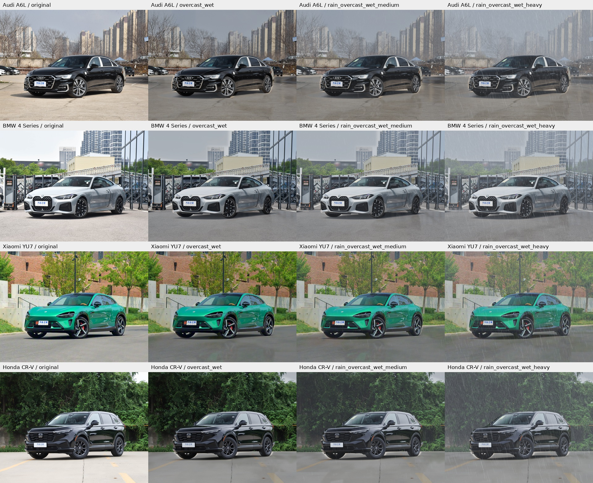

[查看物理方法大图](docs/assets/physics-overcast-wet-overview.jpg)。车辆沿用原图结构，雨丝与空气散射随预设增强，但车身仍保留部分晴天反射，阴天照明和路面反射为程序化近似。来源：`01_physics_based/outputs/overcast_wet_v3/previews/overview.jpg`。

### Qwen：四类天气编辑

从左到右：**原图 → 阴天湿路 → 中雨 → 薄雾 → 降雪与部分积雪**。原图列使用缩至工作分辨率的 `source_working.png`。

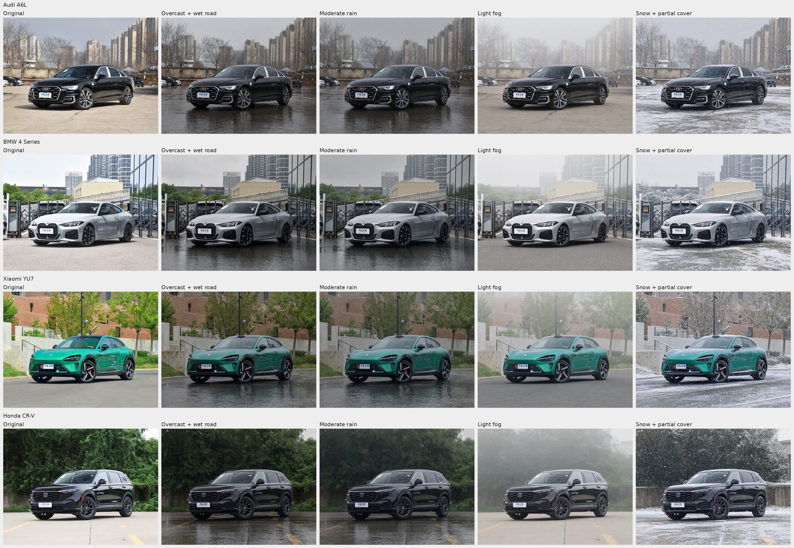

[查看 Qwen 大图](docs/assets/qwen-weather-overview.jpg)。阴天光照、湿地反光、雾化和积雪变化可见；生成方法可能改动车辆细节及背景，逐图检查记录见[Qwen 方法文档](docs/02_qwen_image_edit.md)。来源：`02_qwen_image_edit/outputs/weather_batch_v2/report/overview.jpg`。

以上均为缩略总览。物理方法原生输出为 3840×2880，Qwen 去边框输出为 2388×1791；两组天气设置与视觉强度未统一标定，仅用于定性展示。细粒度保真仍需结合原生分辨率部件裁剪检查。

### 光照增强：过曝、光晕与眩光

使用 `--profile refined`，依次为**高光过曝 +1.5 EV、亮部光晕、阳光眩光、镜头眩光**。眩光采用画外入射光、随位置变化的近中性光幕及柔和鬼影。

从左到右：**原图 → 过曝 → 光晕 → 阳光眩光 → 镜头眩光**。四辆车共 16 张 3840×2880 输出。

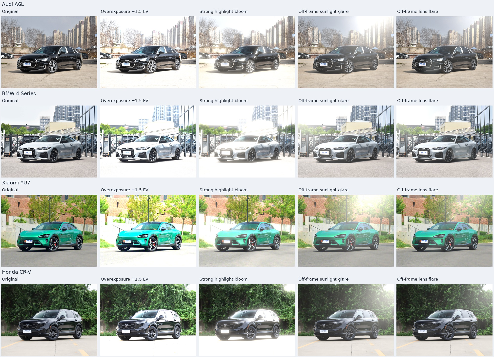

[查看改进组大图](docs/assets/lighting-refined-overview.jpg) · [方法、参数与实测记录](docs/03_lighting_augmentation.md)。本地完整图库为 `03_lighting_augmentation/outputs/refined_v1/report/index.html`，包含整图、车灯、格栅、前后轮及短边 224 诊断。入射位置按图人工配置，不是自动恢复真实太阳方向，也不是实拍眩光模板或经标定的镜头光线追踪。

### 成像质量增强：失焦、运动、噪声、低分辨率与压缩

使用 `--profile strong`，包含两档失焦、当前原图上的 90 像素运动拖影、粗颗粒相关噪声、短边 160／80 的低分辨率，以及 JPEG quality 5／1 压缩。各预设从原图独立生成，JPEG 在原尺寸编码。

从左到右：**原图 → 轻度失焦 → 明显失焦 → 强运动模糊 → 粗颗粒噪声 → 短边 160 → 短边 80 → JPEG quality 5 → JPEG quality 1**。

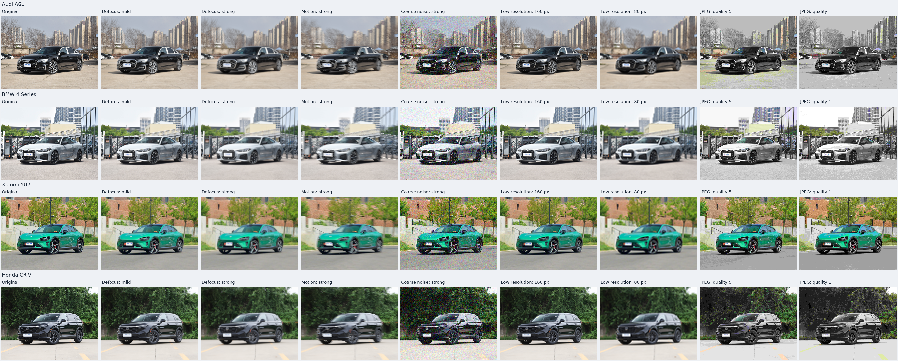

[查看强档无损总览](docs/assets/imaging-quality-strong-overview.png) · [方法、参数与运行记录](docs/04_imaging_quality.md)。本地完整图库为 `04_imaging_quality/outputs/quality_strong_v1/report/index.html`，包含全部八种效果的整图、四部件、原生裁剪及短边 224 诊断。粗噪声只放大随机残差场后加回原图，不对原图信号做降分辨率。

全部拼图使用 PNG，避免预览再次经过 JPEG 编码。JPEG quality 1 是极强压力档，色阶断裂和掉色也属于压缩结果，训练强度仍需结合实际分类输入尺寸选择。当前强档 **32 项测试及 201 个 PNG 检查通过**；短边 224 的诊断结果见方法文档。

### 构图与尺度增强：明显改变车辆占比、位置和倾斜

八种预设分别为 **1.30 倍近景、1.60 倍紧裁剪、左偏、右偏、上偏、下偏、左倾 −12°、右倾 +12°**。近景让现有车辆宽度占比由约 69% 增至约 89%；紧裁剪允许部分车头或车尾出框。所有预设从原图独立生成，保持输出画布尺寸，不扩背景或反射补边。

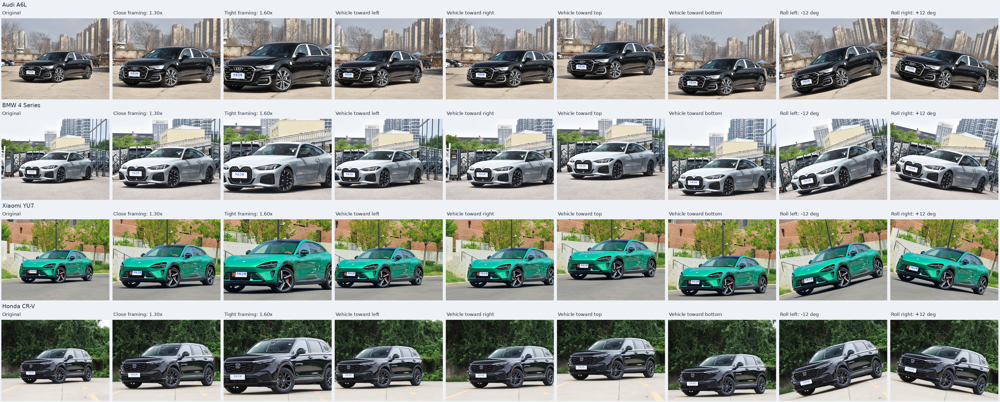

[查看整图总览](docs/assets/composition-scale-overview.png) · [宝马单车九宫格](docs/assets/composition-scale-example.png) · [方法、坐标处理与运行说明](docs/05_composition_scale.md)。从左到右为原图及上述八种预设。本地完整图库为 `05_composition_scale/outputs/composition_v1/report/index.html`。

下面是宝马的对应部件精选：列为**原图／紧裁剪 1.60 倍／右偏／右倾 +12°**，行为**车灯／格栅／前轮／后轮**。紧裁剪的后轮区域保留约 59.2%，右偏约 88.9%。

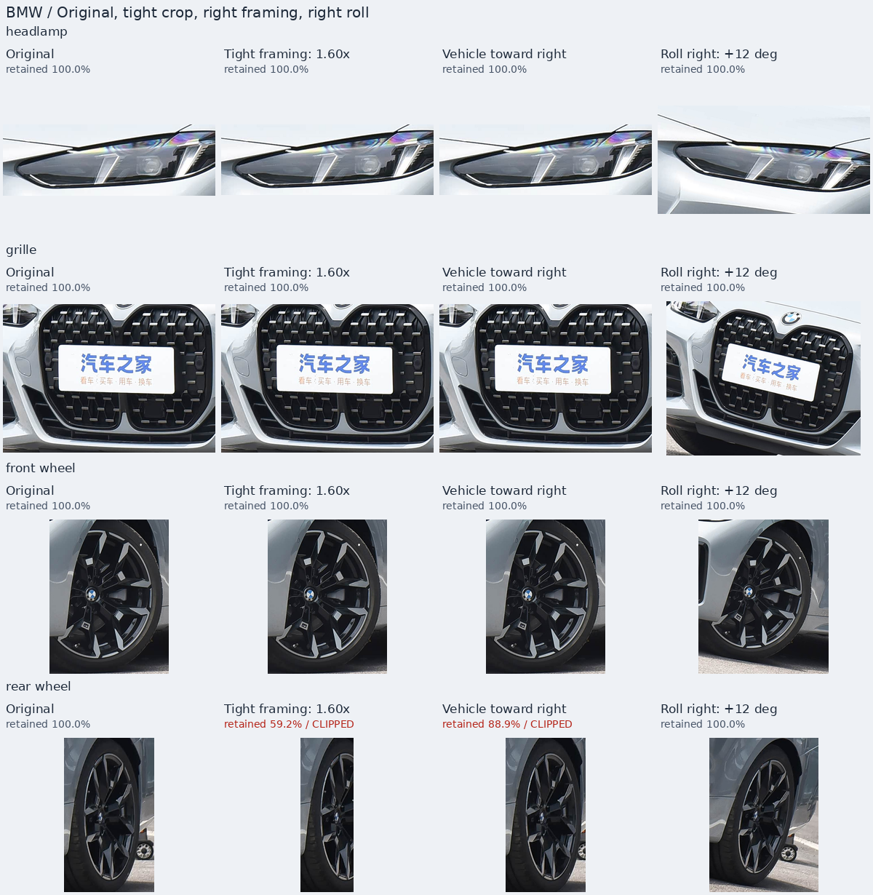

[查看部件精选](docs/assets/composition-scale-parts.png)。部件随变换定位，再按展示格子缩放，因此完整部件在放大或平移后可能看起来相近；尺度、位置看整图，结构和截断看原生裁剪及保留率。

[查看原图取景框示意](docs/assets/composition-scale-framing.png)：宝马三行三列，按行依次为原图、近景、紧裁剪、左偏、右偏、上偏、下偏、左倾、右倾，与单车九宫格顺序一致。橙框由输出四角逆映射到原图，显示实际取景范围。所有标注线只出现在诊断图中，主输出不画线。

本轮 32 张主图、32 张全有效 mask、144 张原生部件裁剪和 25 张预览，共 **233 个 PNG 校验通过，27 项测试通过**。CPU 全流程耗时 149.836 秒，原图哈希未变。近景、上下偏置和倾斜完整保留主体；紧裁剪主体保留约 94.75%–95.86%，关键部件损失需单独检查。

### 局部遮挡：用户枝叶素材与奥迪单图演示

使用用户提供的 1000×707 枝叶图作为前景，叠加在奥迪 A6L 原图上。素材原文件是带白灰棋盘图案的 RGB 图片，需先通过专用浅色棋盘去底得到真正的 RGBA；普通透明 PNG 可直接复用合成引擎。当前展示 **1 张 3840×2880 演示主图**。

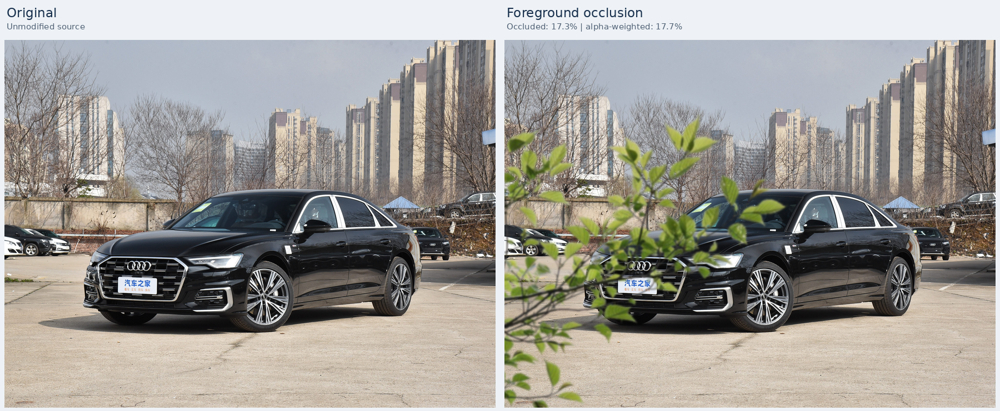

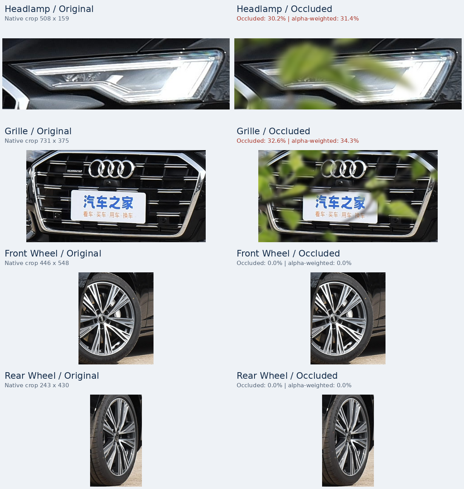

[查看整图对比](docs/assets/local-occlusion-example.png) · [查看部件对比](docs/assets/local-occlusion-parts.png) · [通用素材、参数及运行说明](docs/06_local_occlusion.md)。部件按行依次为车灯、格栅、前轮、后轮；左列为原图，右列为遮挡结果。原图及部件坐标保持固定，报告统计各区域的遮挡比例。

合成不使用大模型或 GPU，未遮挡区域保持原图像素；素材摆放由配置指定，不会自动搜索最优位置。绿色枝叶与原图冬季背景存在季节差异，本例用于验证合成和遮挡强度，没有全局重绘场景来消除这种差异。

本例车辆轮廓的不透明遮挡率约 **17.26%**；车灯、格栅 ROI 分别约 **30.23%／32.56%**，前后轮均未被覆盖。**29 项测试通过，27 个输出 PNG 校验通过**。完整报告同时记录 alpha 加权覆盖和短边 224 诊断；部件矩形中的背景也参与统计，数值不是车型信息损失率。

### 局部遮挡：服务器 Qwen 骑行者融合

本地 Qwen-Image-2.1 接收奥迪原图和骑行者布局参考，处理素材棋盘背景、光照与前景融合，生成一张 1536×1152 结果。当前使用近景比例：头部高于车顶，人物和自行车从左侧与底边进入，保留部分车轮、隐藏接地点，并带有轻微横向运动拖影。此路径独立于上面的 CPU 枝叶算法。

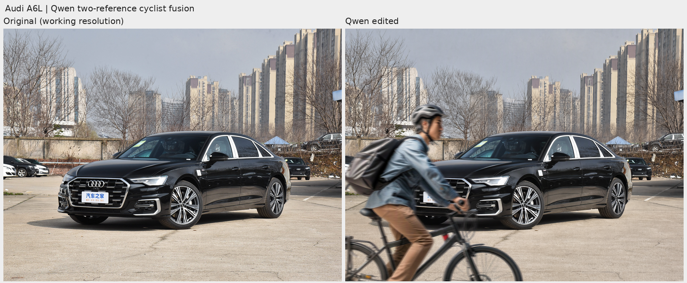

[查看整图对比](docs/assets/qwen-cyclist-foreground-scale-example.png) · [车灯与轮毂对比](docs/assets/qwen-cyclist-foreground-scale-parts.jpg) · [当前配置](06_local_occlusion/configs/qwen_cyclist_foreground_scale_v2.json) · [方法与实测](docs/06_local_occlusion.md#增大近景比例2026-11-11)。骑行者遮住部分车头与格栅，大部分车身仍然可见；布局由参考图和提示词引导，不保证未遮挡部件逐像素不变。当前样例生成约 41.05 秒，峰值已分配显存约 48.32 GiB，训练收益尚未验证。

### 局部遮挡：小米 YU7 的树枝与骑行者融合

同一张绿色小米 YU7 原图，分别加入用户提供的树枝和骑行者素材。两版均由服务器上的 **Qwen-Image-2.1** 双参考融合生成，输出为 **1536×1152**。树枝从左侧伸入，覆盖机盖、部分头灯和前保险杠；近景骑行者覆盖车头，保留部分自行车轮并带有横向运动模糊。两版都保留大部分车侧与汽车车轮。

| 树枝遮挡 | 骑行者遮挡 |
| --- | --- |
| 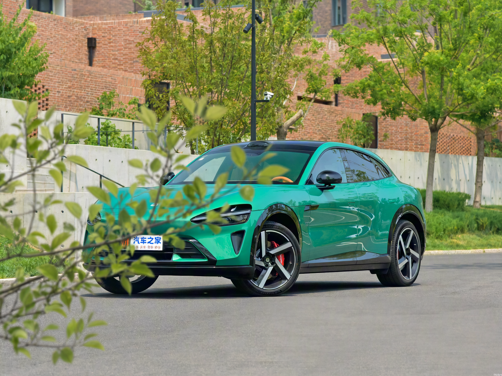 | 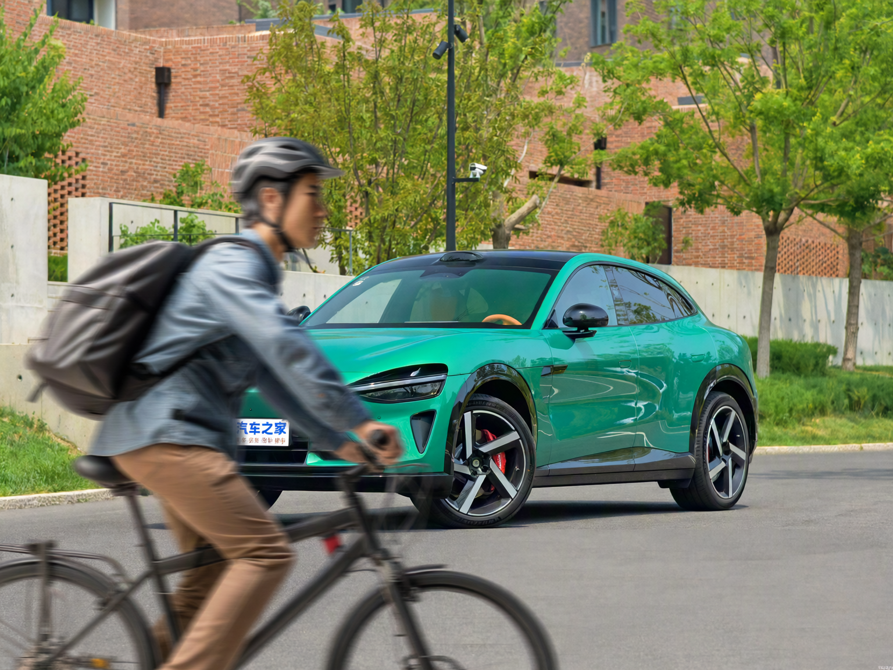 |

[查看树枝原尺寸 PNG](docs/assets/qwen-yu7-branches.png) · [查看骑行者原尺寸 PNG](docs/assets/qwen-yu7-cyclist.png)。以下三列统一为 **原图 → 树枝遮挡 → 骑行者遮挡**，原图缩至相同工作尺寸用于对照。

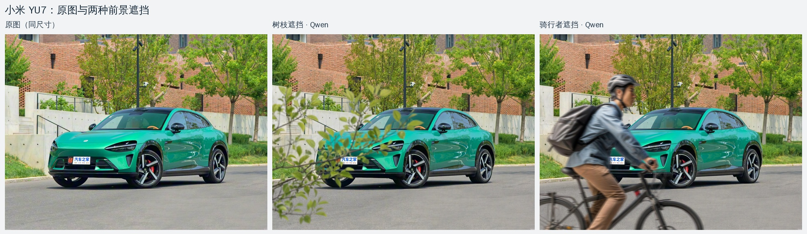

车头放大图用于检查素材是否实际覆盖机盖、灯具和前保险杠：

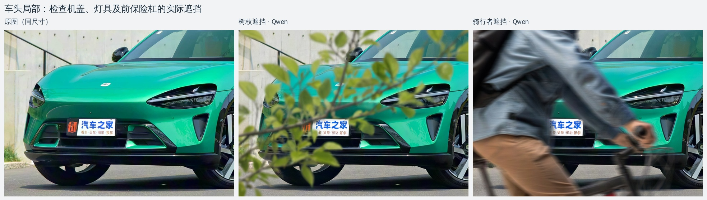

关键部件按行依次为 **头灯、前脸／下格栅、前轮、后轮**，列顺序与整图一致：

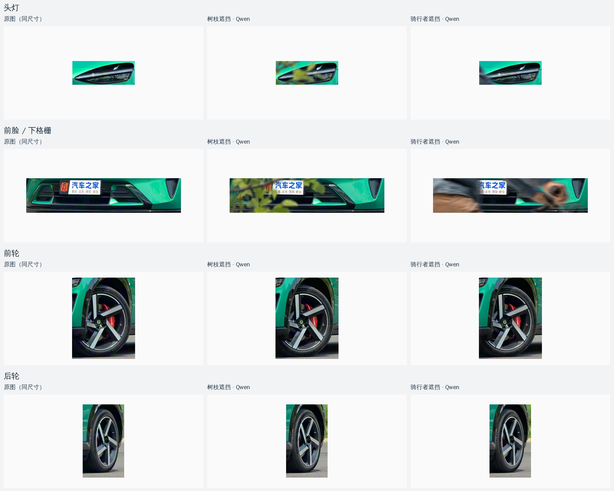

[整图大图](docs/assets/qwen-yu7-occlusion-overview.jpg) · [车头放大图](docs/assets/qwen-yu7-occlusion-detail.jpg) · [部件大图](docs/assets/qwen-yu7-occlusion-parts.jpg) · [布局、配置与复跑方法](docs/06_local_occlusion.md#yu7-occlusion)。两张单图保留生成 PNG，对比页使用 JPEG；以上图片均随仓库保存，可在 GitHub 直接浏览。

布局参考与提示词用于引导位置、比例和模糊，不能精确锁定生成结果。Qwen 仍会重绘未遮挡的灯内纹理、轮毂／轮胎细节和车牌小字；这些展示图未使用原车像素贴回，没有精确生成遮挡 mask。单张推理约 41 秒，峰值已分配显存约 48.3 GiB。

## 目录结构

```text
CarImageAugmentation/
├── README.md                         # 项目介绍与运行入口
├── docs/                             # 方法说明、实验记录与研究方案
│   ├── README.md                     # 完整文档索引
│   ├── assets/                       # 随仓库提交的效果对比预览图
│   ├── 01_physics_based.md
│   ├── 01_physics_results.md
│   ├── 02_qwen_image_edit.md
│   ├── 03_lighting_augmentation.md
│   ├── 04_imaging_quality.md
│   ├── 05_composition_scale.md
│   ├── 06_local_occlusion.md
│   ├── 03_sdxl_controlnet_ipadapter.md
│   ├── generative_weather_plan.md
│   ├── research_proposal.md
│   └── HANDOFF.md
├── test_images/                      # 四张共享原图，各方法只读取
├── models/                           # 本地模型权重，不纳入 Git
│   └── Qwen-Image-2.1/
├── 01_physics_based/
│   ├── configs/                      # scenes.json 场景几何、presets.json 天气参数
│   ├── src/                          # 雨雾成像、阴天照明与湿路面实现
│   ├── tests/                        # 成像、复现与车辆保护区测试
│   ├── run.py                        # 物理增强入口
│   ├── compare_runs.py               # 雨天与阴天湿地实验对比
│   ├── requirements.txt
│   └── outputs/                      # 本地生成结果，不纳入 Git
├── 02_qwen_image_edit/
│   ├── configs/                      # 单图提示词与参数、批次任务清单
│   ├── run.py                        # 单图离线推理与部件预览
│   ├── run_batch.py                  # 串行批处理、日志与已有结果校验
│   ├── summarize_batch.py            # 文件校验、HTML 图库与总览
│   ├── requirements.txt
│   └── outputs/                      # 本地生成结果，不纳入 Git
├── 03_lighting_augmentation/
│   ├── configs/                     # 光照预设，当前展示使用 refined
│   ├── lighting/                    # 光度变换、光学效果、整图与部件报告
│   ├── tests/                       # 数值性质、输入保护和裁剪一致性
│   ├── run.py                       # CPU 生成、诊断与报告入口
│   ├── requirements.txt
│   └── outputs/                     # 原尺寸 PNG、裁剪、预览和运行清单
├── 04_imaging_quality/               # 清单方法 2：成像质量增强
│   ├── configs/                     # basic / strong 两组独立退化预设
│   ├── quality/                     # 数值变换、无损预览与部件报告
│   ├── tests/                       # 成像性质、复现与文件一致性
│   ├── run.py                       # CPU 生成、诊断与报告入口
│   ├── requirements.txt
│   └── outputs/                     # PNG、真实 JPEG、小图和运行清单
├── 05_composition_scale/             # 清单方法 3：构图与尺度增强
│   ├── configs/                     # 八种几何预设
│   ├── composition/                 # 仿射变换、标注映射与对比报告
│   ├── tests/                       # 几何性质、裁剪与输入保护
│   ├── run.py                       # CPU 生成、几何诊断与报告入口
│   ├── requirements.txt
│   └── outputs/                     # 主图、有效 mask、裁剪与运行清单
└── 06_local_occlusion/               # 清单方法 5：RGBA 与 Qwen 局部遮挡
    ├── assets/                      # 用户枝叶／骑行者素材、RGBA 与准备记录
    ├── configs/                     # CPU 摆放参数及 Qwen 双参考融合配置
    ├── occlusion/                   # 素材去底、通用合成、遮挡统计与报告
    ├── tests/                       # 合成、素材、输入保护与裁剪核验
    ├── prepare_asset.py             # 准备真正的透明素材
    ├── run.py                       # 单图合成与报告入口
    ├── run_qwen.py                  # 本地 Qwen 双参考融合与部件对比
    ├── requirements.txt
    └── outputs/                     # 主图、遮挡 mask、裁剪与运行清单
```

仓库包含代码、配置、文档、测试原图及 `docs/assets/` 中的精选预览图。`models/`、各方法的 `outputs/`、Python 缓存与虚拟环境由 `.gitignore` 排除，克隆后需另行准备权重并生成完整结果。README 中的精选预览可直接浏览；详细文档中指向历史 `outputs/` 的图片链接仍需对应本地输出。

## 获取项目

```bash
git clone https://github.com/WYHorizon/CarImageAugmentation.git
cd CarImageAugmentation
```

以下命令均从**项目根目录**执行，面向 Linux/Bash。物理天气、光照、成像质量、构图和 CPU 局部遮挡方法只依赖 NumPy/Pillow；Qwen 天气编辑与双参考融合使用独立模型环境。已有本地项目可直接进入项目根目录，无需再次克隆。

## 运行物理天气增强

### 1. 准备环境

使用 Python 3.10 或更高版本，仅需 NumPy 和 Pillow，无需 GPU。

```bash
python3 -m venv 01_physics_based/.venv
source 01_physics_based/.venv/bin/activate
python -m pip install -r 01_physics_based/requirements.txt
```

### 2. 生成样图

下面读取 `test_images/` 中的四张原图，生成薄雾、较明显雾和小雨，共 12 张原分辨率 PNG：

```bash
python 01_physics_based/run.py \
  --weather fog_light fog_medium rain_light \
  --output-dir 01_physics_based/outputs/demo_run
```

生成阴天湿地、湿地中雨与湿地大雨：

```bash
python 01_physics_based/run.py \
  --weather overcast_wet rain_overcast_wet_medium rain_overcast_wet_heavy \
  --output-dir 01_physics_based/outputs/wet_run
```

| 参数／配置 | 用途 |
| --- | --- |
| `--input-dir` | 原图目录，默认 `test_images/` |
| `--weather` | 可指定多个天气预设 |
| `--count` / `--seed` | 每种雨天的随机变体数／基础种子，默认 1／42；雾为确定性变换 |
| `--scenes` / `--presets` | 自定义场景配置／天气预设文件 |
| `--output-dir` | 输出目录，必须不存在或为空，且不能位于输入目录内 |

支持的预设为 `fog_light`、`fog_medium`、`rain_light`、`rain_medium`、`rain_heavy`、`overcast_wet`、`rain_overcast_wet_medium`、`rain_overcast_wet_heavy`。雨量名称表示视觉强度，未按真实 mm/h 标定。

输出目录包含 `images/`、`previews/`、`diagnostics/`、`config_snapshot/` 和 `manifest.json`，可先查看 `previews/overview.jpg` 与部件对比图。

### 3. 运行测试

```bash
python -m unittest discover -s 01_physics_based/tests -v
```

新增图片时，必须在 [scenes.json](01_physics_based/configs/scenes.json) 中添加同名条目，配置车辆轮廓、近似深度、相机和部件区域；阴天湿地还需对应的 `weather_geometry`。坐标基于 EXIF 方向校正后的图像，归一化到 `[0,1]`。当前没有自动适配任意新图的几何估计流程。

## 运行光照与光学退化增强

使用 Python 3.10+ 和 NumPy/Pillow，可复用物理方法环境，无需 GPU 或模型权重。从项目根目录执行：

```bash
python -m pip install -r 03_lighting_augmentation/requirements.txt

python 03_lighting_augmentation/run.py \
  --profile refined \
  --output-dir 03_lighting_augmentation/outputs/refined_new_run \
  --check-config

python 03_lighting_augmentation/run.py \
  --profile refined \
  --output-dir 03_lighting_augmentation/outputs/refined_new_run

python -m unittest discover -s 03_lighting_augmentation/tests -v
```

上例选择 refined，处理四张共享原图和四种预设，生成 16 张 PNG。请显式传入 `--profile refined` 复现首页效果；不传 profile 时默认 basic，其他预设见详细方法文档。`--check-config` 只预检，不创建输出。正式输出目录必须不存在或为空，禁止写入原图和模型目录。完成后打开输出目录下的 `report/index.html`，查看整图、关键部件、原生裁剪和运行指标。

光度变换和二维光学效果不依赖车辆分割；批处理报告要求 `--scenes` 中具有同名图像条目及 `regions`，默认复用物理方法的场景配置。区域和车辆轮廓只用于报告与诊断，不改变增强作用范围。详见[光照增强方法](docs/03_lighting_augmentation.md)。

## 运行成像质量增强（清单方法 2）

使用 Python 3.10+ 和 NumPy/Pillow，无需模型或 GPU，可复用上述 CPU 环境。目录编号 `04` 是项目方法目录的创建顺序，对应增强清单中的第 2 项。

```bash
python -m pip install -r 04_imaging_quality/requirements.txt

python 04_imaging_quality/run.py \
  --profile strong \
  --output-dir 04_imaging_quality/outputs/quality_strong_new_run \
  --check-config

python 04_imaging_quality/run.py \
  --profile strong \
  --output-dir 04_imaging_quality/outputs/quality_strong_new_run

python -m unittest discover -s 04_imaging_quality/tests -v
```

上例使用强档，四张原图、八个预设，共生成 32 张原尺寸 PNG、8 张实际低分辨率 PNG 和 8 个实际编码的 JPEG，另有无损整图／部件预览、原生裁剪、HTML 图库和运行清单。原尺寸 PNG 是统一对照格式；低分辨率放大不会恢复细节，JPEG 对应的 PNG 则是该 JPEG 的解码结果。每次运行使用不存在或为空的新目录。

`--profile basic` 保留原基础组，不传 profile 也仍为 basic。强档可加 `--effects motion_strong coarse_noise jpeg_q1` 只运行指定预设；`--seed` 默认 42，噪声按原图内容和预设 ID 稳定派生种子，不随输入遍历顺序改变。新原图需在 `--scenes` 指向的 JSON 中配置同名条目和部件区域，默认共享物理方法的场景文件。区域仅用于对照与指标，退化作用于整图。完整参数、输出解释与限制见[成像质量增强方法](docs/04_imaging_quality.md)。

增强核心适用于其他图片，不依赖样例车型或文件名。批处理换图时修改 `--input-dir` 和 `--scenes`；只看整图可为每张图配置一个 `[0,0,1,1]` 全图区域，无需标注车辆部件。也可以直接调用 `apply_quality(rgb, preset, seed)`，完全不需要场景配置。[自定义图片与参数示例](docs/04_imaging_quality.md#换成自己的图片)包含两种用法。

## 运行构图与尺度增强（清单方法 3）

使用 Python 3.10+ 和 NumPy/Pillow，无需模型或 GPU。首轮是八种确定性预设，每种独立作用于原图：

```bash
python -m pip install -r 05_composition_scale/requirements.txt

python 05_composition_scale/run.py \
  --output-dir 05_composition_scale/outputs/composition_new_run \
  --check-config

python 05_composition_scale/run.py \
  --output-dir 05_composition_scale/outputs/composition_new_run

python -m unittest discover -s 05_composition_scale/tests -v
```

可加 `--effects zoom_close zoom_tight position_left roll_right` 只运行部分预设。默认共享四张原图及场景配置，新增图片通过 `--input-dir` 和 `--scenes` 指定；部件区域必须针对新图配置。车辆多边形用于放大锚点和主体保留统计，没有轮廓时使用图像中心。几何核心适用于其他图片，报告将标注随同一矩阵映射后再裁对应部件。

输出包含原尺寸 PNG、有效像素 mask、整图及原图取景框、变换后部件标注、原生部件裁剪、短边 224 诊断和 HTML 图库。完全出框的部件标为不可见，部分出框记录保留比例。完整与截断预设的区别、坐标约定及输出解释见[构图与尺度增强方法](docs/05_composition_scale.md)。

## 运行局部遮挡演示（清单方法 5）

使用已准备好的枝叶 RGBA 与奥迪原图，运行一个固定配置的合成示例：

```bash
python -m pip install -r 06_local_occlusion/requirements.txt

python 06_local_occlusion/run.py \
  --output-dir 06_local_occlusion/outputs/branches_new_run \
  --check-config

python 06_local_occlusion/run.py \
  --output-dir 06_local_occlusion/outputs/branches_new_run

python -m unittest discover -s 06_local_occlusion/tests -v
```

`--input` 更换目标图片，`--asset` 更换透明素材，`--preset` 调整素材缩放、位置、旋转、翻转、模糊和前景颜色。换素材通常只需增加图片与配置；当前未实现按类别自动摆放或地面阴影。`--scenes` 提供同名车辆轮廓和部件区域；未知文件名自动使用整图对照，缺少车辆标注时不计算整车遮挡率。

输出包括一张增强主图、输入快照、alpha／不透明遮挡 mask、车辆可见区域、整图和部件预览、原生与短边 224 裁剪、HTML 图库和运行清单。[局部遮挡方法文档](docs/06_local_occlusion.md)包含伪棋盘素材去底命令、完整参数和复用边界。

使用服务器已有 Qwen 融合素材时，调用独立的 [run_qwen.py](06_local_occlusion/run_qwen.py)。小米 YU7 两版分别使用车辆原图与树枝／骑行者布局参考；树枝参考由 RGBA 合成得到，骑行者参考保留棋盘底交由模型处理。先检查 GPU 空闲情况；下面的 GPU 2 需按实际空闲设备调整，输出目录必须尚不存在：

```bash
nvidia-smi
CUDA_VISIBLE_DEVICES=2 /nas/wyh/.conda/envs/car-weather-qwen21/bin/python \
  06_local_occlusion/run_qwen.py \
  --config 06_local_occlusion/configs/qwen_branches_yu7_v1.json \
  --output-dir 06_local_occlusion/outputs/qwen_branches_yu7_new_run

CUDA_VISIBLE_DEVICES=2 /nas/wyh/.conda/envs/car-weather-qwen21/bin/python \
  06_local_occlusion/run_qwen.py \
  --config 06_local_occlusion/configs/qwen_cyclist_yu7_v1.json \
  --output-dir 06_local_occlusion/outputs/qwen_cyclist_yu7_new_run
```

该入口沿用本地模型环境及共享权重，保存原始生成图和部件对比；未遮挡区域可能被重绘，不能沿用 CPU 路径的像素保真及遮挡率结论。[Qwen 融合配置、命令与限制](docs/06_local_occlusion.md#本地-qwen-双参考融合)。

## 运行 Qwen 天气编辑

### 1. 环境与权重

已验证环境使用 Python 3.12、PyTorch 2.7.1+cu118、Diffusers 0.42.1 和 Transformers 5.22.2，完整核心版本见 [requirements.txt](02_qwen_image_edit/requirements.txt)。需要支持 BF16 的 NVIDIA CUDA GPU。

原实验在 A800 80GB 上运行：2400×1792 画布、40 步、seed 42，单张生成约 116–117 秒，峰值已分配显存约 65.5 GiB、预留显存最高约 76.4 GiB。这些是该配置的实测值，其他硬件与参数需要单独验证。

已有服务器环境可直接激活：

```bash
conda activate /nas/wyh/.conda/envs/car-weather-qwen21
```

在新机器上，也可用独立 Python 3.12 虚拟环境安装记录的依赖：

```bash
python3.12 -m venv 02_qwen_image_edit/.venv
source 02_qwen_image_edit/.venv/bin/activate
python -m pip install torch==2.7.1+cu118 torchvision==0.22.1+cu118 \
  --index-url https://download.pytorch.org/whl/cu118
python -m pip install -r 02_qwen_image_edit/requirements.txt
```

从 [Qwen 模型仓库](https://huggingface.co/Qwen/Qwen-Image-2.1) 准备指定 revision 的完整权重（约 33 GB）：

```bash
hf download Qwen/Qwen-Image-2.1 \
  --revision d26bb61231c349cf6b7896fa83353113880e1ba3 \
  --local-dir models/Qwen-Image-2.1
```

推理脚本只做离线加载，不会自动下载模型。保留下载工具生成的 `models/Qwen-Image-2.1/.cache/huggingface/download/` 元数据；脚本会读取其中的 `model_index.json.metadata`，核对 revision 与单图配置是否一致。

迁移到新机器前还需检查两个本地路径：

- [run.py](02_qwen_image_edit/run.py) 的 `CACHE` 当前固定为 `/nas/wyh/.cache`。确保该目录及代码指定的缓存、临时子目录存在且可写，或将 `CACHE` 改为本机路径；脚本会覆盖相应环境变量。
- 预览使用 `/usr/share/fonts/truetype/dejavu/DejaVuSans.ttf`，需保证该字体存在，或调整代码中的字体路径。

### 2. 检查配置并运行单图

先检查空闲 GPU 和输入配置。下例中的 GPU `0` 只是示例，应按实际空闲设备选择：

```bash
nvidia-smi

python 02_qwen_image_edit/run.py \
  --config 02_qwen_image_edit/configs/audi_overcast_wet_seed42.json \
  --output-dir 02_qwen_image_edit/outputs/audi_overcast_wet_run \
  --check-config
```

`--check-config` 不加载模型权重、不生成图片，但仍需要已安装的 Diffusers、原图、场景配置及上述模型下载元数据。该命令不会创建输出目录。

检查通过后，用同一配置生成：

```bash
CUDA_VISIBLE_DEVICES=0 python 02_qwen_image_edit/run.py \
  --config 02_qwen_image_edit/configs/audi_overcast_wet_seed42.json \
  --output-dir 02_qwen_image_edit/outputs/audi_overcast_wet_run
```

输出目录必须尚不存在，不能写入原图或模型目录。重复实验请更换目录名。配置文件中的 `input_image`、`model_dir` 和 `scene_config` 相对于项目根目录解析；命令行中的相对路径按执行目录解析。

默认配置将 3840×2880 原图等比例缩至 2388×1791，再补边为 2400×1792 输入画布；输出仅去除已记录的补边，不放大回 4K。主要文件包括：

| 输出 | 内容 |
| --- | --- |
| `source_working.png` / `source_canvas.png` | 同尺寸对照原图／实际输入画布 |
| `edited.png` / `edited_canvas.png` | 去边框结果／模型原始画布输出 |
| `previews/` / `crops/` | 整图、整车及部件对比／原生分辨率裁剪 |
| `manifest.json` / `progress.json` | 参数、哈希、耗时、显存与运行状态／逐步进度 |
| `config.json` / `run_snapshot.py` / `environment_freeze.txt` | 本次配置、代码和依赖快照 |

### 3. 批量生成与汇总

可先使用没有旧结果复用依赖的四车雪景批次：

```bash
python 02_qwen_image_edit/run_batch.py \
  --batch-config 02_qwen_image_edit/configs/snow_batch_v1.json \
  --output-dir 02_qwen_image_edit/outputs/snow_batch_v1 \
  --gpu 0

python 02_qwen_image_edit/summarize_batch.py \
  --batch-config 02_qwen_image_edit/configs/snow_batch_v1.json \
  --output-dir 02_qwen_image_edit/outputs/snow_batch_v1/report
```

批处理串行执行，记录 `batch_status.json` 和 `logs/`，对已有结果校验配置与哈希后复用。当前执行器要求指定 GPU 至少有 **80000 MiB 空闲显存**，最多等待 30 分钟；这是现有 2K 配置的门槛，不会自动适配小显存设备。

批处理的 `--output-dir` 只决定批次日志与状态目录，必须位于 `02_qwen_image_edit/outputs/` 内；**各图实际输出位置由批次 JSON 中的 `jobs[].output_dir` 决定**。新实验应复制批次配置，更新 `batch_id` 和各图输出目录；不依赖旧结果时将相应 `reuse` 设为 `false`。

`weather_batch_v1.json` 要求复用首张奥迪雨后结果，`weather_batch_v2.json` 要求复用已有的 12 个雨／雾结果。刚克隆仓库时这些输出不存在，不能直接将历史批次作为全新生成任务运行；需要先准备其引用的结果，或按上述规则制作新批次配置。

汇总后打开本地 `02_qwen_image_edit/outputs/snow_batch_v1/report/index.html` 查看图库，`summary.json` 记录文件检查结果。汇总工具不执行视觉保真验收。

## 实验与数据约定

- 原图集中保存在 `test_images/`，各方法共享读取，实验使用独立输出目录。
- 新增 Qwen 输入也需在场景配置中添加同名条目，用于整车和部件对照。当前提示词中的“保持细节”是软约束，需逐图检查生成结果。
- `complete_pending_visual_review` 表示生成与记录完成，仍需检查车型特征、天气效果及背景布局变化。
- 训练、验证、测试应按原始照片及拍摄组划分，同一原图的所有增强版本留在同一集合，避免数据泄漏。
- 四张展示原图只用于方法验证。下游收益需要独立真实天气测试集及分类训练实验支持。

## 详细文档

| 文档 | 内容 |
| --- | --- |
| [文档索引](docs/README.md) | 全部说明与目录约定 |
| [物理方法](docs/01_physics_based.md) · [实验结果](docs/01_physics_results.md) | 成像模型、参数、保真边界与三轮记录 |
| [Qwen 编辑方法](docs/02_qwen_image_edit.md) | 单图与批次结果、资源消耗、视觉检查 |
| [光照与光学退化增强](docs/03_lighting_augmentation.md) | 当前改进眩光与保留的过曝／光晕、整图／部件对比及历史实验 |
| [成像质量增强](docs/04_imaging_quality.md) | 失焦、运动模糊、噪声、低分辨率、JPEG 压缩与无损对比 |
| [构图与尺度增强](docs/05_composition_scale.md) | 明显缩放、偏置取景和倾斜，坐标同步映射及部件可见性 |
| [局部遮挡增强](docs/06_local_occlusion.md) | CPU 枝叶合成与遮挡率；本地 Qwen 骑行者双参考融合 |
| [生成模型方案](docs/generative_weather_plan.md) | 候选路线与实验验收流程 |
| [SDXL 备选路线](docs/03_sdxl_controlnet_ipadapter.md) | 暂缓实施的结构与参考条件方案 |
| [论文研究方案](docs/research_proposal.md) | 判别部件保真候选、评测协议与最小验证计划 |
| [项目交接记录](docs/HANDOFF.md) | 历史进展与环境快照，以各段标注时间为准 |
