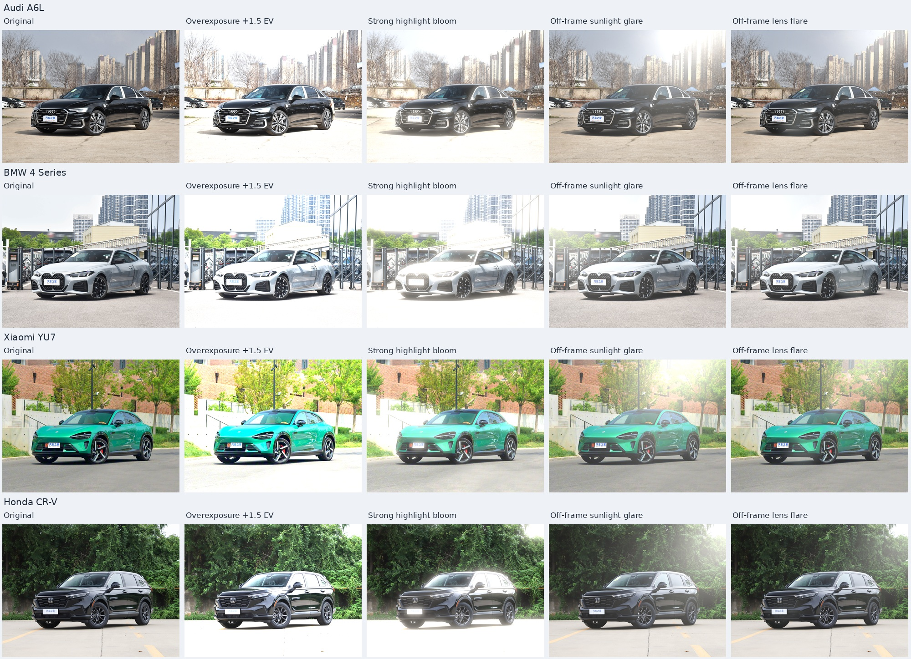
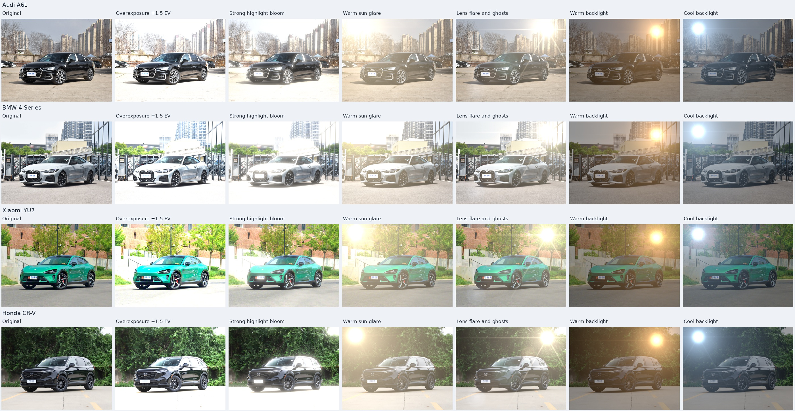

# 03 — 光照与光学退化增强

[文档首页](README.md) · [项目首页](../README.md)

本方法使用 NumPy/Pillow。当前展示使用 `refined`：保留旧强光组的过曝和亮部光晕，改进阳光眩光与镜头眩光，共四种预设，暂不生成逆光。`basic` 保留轻量曝光、对比度和冷暖偏移；`strong` 保留旧版六种强光效果用于复现历史对照。无需大模型、权重下载或 GPU，输出保持 EXIF 方向校正后的原图分辨率与像素坐标。光晕和眩光会扩散或叠加光，主动改变局部可见性；当前没有重建真实几何、投影阴影或车身材质反射。

实现入口：[运行脚本](../03_lighting_augmentation/run.py) · [数值变换](../03_lighting_augmentation/lighting/transforms.py) · [预览与报告](../03_lighting_augmentation/lighting/report.py) · [基础预设](../03_lighting_augmentation/configs/presets.json) · [强光预设](../03_lighting_augmentation/configs/strong_presets.json) · [光学效果实现](../03_lighting_augmentation/lighting/effects.py) · [改进眩光配置](../03_lighting_augmentation/configs/refined_presets.json) · [改进眩光实现](../03_lighting_augmentation/lighting/glare.py)。

## 当前改进组：保留前两种，重做眩光

| 预设 ID | 当前处理 | 与旧强光组的关系 |
| --- | --- | --- |
| `strong_overexposure` | +1.5 EV 曝光，提高亮度并允许明显高光截断 | 参数和数值变换保持不变 |
| `highlight_bloom` | 已有亮部的多尺度扩散 | 参数和数值变换保持不变 |
| `sun_glare` | 画外强光在画面边缘及内部形成空间变化的近中性光幕 | 新的 `camera_glare` 实现，不绘制画内太阳光球 |
| `lens_flare` | 画外光幕与沿光源—光轴关系分布的柔和镜头鬼影 | 新的 `camera_glare` 实现，去掉固定星芒与旧版规则光球 |

前两种继续使用 `strong_presets.json` 对应的数值和原有算法。后两种从同一原图独立生成，不先叠加过曝或光晕，也不通过把原图部件贴回来隐藏遮蔽。冷暖逆光只保留在历史组，本轮不生成。

眩光改进的目标是保留可见变化，同时减少与背景冲突的光源本体和过强的整图色雾。光源必须位于画外，画内只呈现进入镜头后的散射光和鬼影；镜头效应可以覆盖前景车辆，不按车辆掩膜将其裁掉。车辆分割与部件框仍只用于诊断和报告。

这套实现是可控的成像现象近似，**没有采用实拍眩光模板，也没有建立经标定的真实镜头光线追踪模型**。它不重新计算地面投影、车身受光或玻璃反射，不应当被描述为完成了真实逆光重光照。

配置中的 `source` 为默认入射位置，`source_overrides` 可按输入文件名设置不同位置。位置是归一化 `[x,y]`，必须在画面范围之外；这些设置是本轮对照的人工假设，不代表从照片唯一推断出真实太阳位置。每张输出的最终参数写入 `manifest.json`，用于审查和复现。覆盖项只允许 `source`、`strength` 和 `ghost_strength`，预检会验证覆盖项，即使相应文件不在本批次中；运行记录的 `source_override_applied` 标记是否使用了覆盖配置。

| 改进眩光参数 | 作用 |
| --- | --- |
| `strength` | 总强度，同时缩放曝光 EV 和叠加的光能；0 为恒等变换 |
| `ev` | 原图的曝光调整；本轮眩光预设为 0，不靠整体提亮制造差异 |
| `source` / `source_overrides` | 默认画外位置与按源文件名覆盖的位置／强度 |
| `color` | 接近中性的叠加光 RGB 比例，略有冷暖差异，不代表标定色温 |
| `scatter_radius` | 散射范围，相对图像短边 |
| `scatter_aspect` / `scatter_falloff` | 沿入射方向的拉伸比例与远离光源时的衰减速度 |
| `veil` / `near_spill` | 长尾光幕与靠近画面边缘的溢光分量 |
| `ghost_strength` / `ghost_scale` | 镜头鬼影的叠加强度与尺度；阳光眩光不启用鬼影 |

实现将坐标分解到光源—画面中心轴线的平行／垂直方向，以椭圆距离构造 `(1+r²)^(-scatter_falloff)` 长尾场，再叠加更靠近画外光源的边缘溢光。镜头眩光额外使用三组柔化的七叶光圈轮廓，位置随光源和画面中心变化，并带有轻微的颜色偏移；这些是假定镜头的现象形态，没有对应某个真实镜头的光学处方。光场在最长边不超过 960 像素的浮点网格计算，再双线性放大到原尺寸，最终输出前不裁切。


本轮使用的眩光参数如下；两种眩光均为 `ev=0`，`scatter_aspect=1.5`、`scatter_falloff=2.2`、`ghost_scale=1.0`。阳光光色为 `[1.0,0.97,0.91]`，镜头光色为 `[1.0,0.98,0.94]`。

| 效果 | 散射半径 | 光幕 `veil` | 边缘溢光 `near_spill` | 默认鬼影强度 |
| --- | --- | --- | --- | --- |
| 阳光眩光 | 0.52 | 0.48 | 0.6 | 0.0 |
| 镜头眩光 | 0.45 | 0.24 | 0.34 | 0.45 |

两种眩光共用每张图的画外入射位置；宝马镜头眩光适当提高强度，本田降低强度。这些是展示用人工配置，不是从影子或反射估计出的真实光源。

| 车辆 | 画外位置 `[x,y]` | 阳光强度 | 镜头强度 | 镜头鬼影强度 |
| --- | --- | --- | --- | --- |
| 奥迪 A6L | `[0.9, -0.12]` | 1 | 1 | 0.45 |
| 宝马 4 系 | `[-0.1, 0.03]` | 1 | 1.3 | 0.65 |
| 小米 YU7 | `[0.8, -0.1]` | 1 | 1 | 0.45 |
| 本田 CR-V | `[1.12, 0.02]` | 0.85 | 0.85 | 0.18 |

## 基础组：六种独立预设

每个预设均直接处理未增强原图，不连续叠加前一张结果。

| 预设 | 图中标签 | 参数 |
| --- | --- | --- |
| `exposure_down` | Exposure -0.3 EV | `ev=-0.3` |
| `exposure_up` | Exposure +0.3 EV | `ev=0.3` |
| `contrast_low` | Contrast 0.9 | `factor=0.9`，`pivot=0.18` |
| `contrast_high` | Contrast 1.1 | `factor=1.1`，`pivot=0.18` |
| `warm` | Warm white balance | 初始 RGB 增益 `[1.05, 1.0, 0.95]` |
| `cool` | Cool white balance | 初始 RGB 增益 `[0.95, 1.0, 1.05]` |

处理顺序为：EXIF 方向校正 → sRGB 解码为近似线性 RGB → 当前预设的光度／光学变换 → 统计显示范围外数值 → 裁切到 `[0,1]` → 编码回 sRGB → 四舍五入为 8-bit RGB → 保存 PNG。JPEG 已包含相机曝光、白平衡和色调处理，解码不能恢复 RAW 或已丢失的动态范围。

**曝光：** `I' = I × 2^EV`。两档线性增益分别约为 0.8123 和 1.2311。

**对比度：** 使用线性亮度 `Y = 0.2126R + 0.7152G + 0.0722B`，计算 `Y' = p × (Y/p)^c`，其中 `p=0.18`，`c` 为对比度参数。对非黑像素以 `Y'/Y` 同比例缩放三个通道，黑像素保持零；裁切前保持色度。`c>1` 时枢轴以下更暗、以上更亮，`c<1` 时相反。这是固定枢轴的幂曲线，不是逐图自动对比度拉伸。

**冷暖变化：** 设配置中的增益为 `g`，实际使用 `g' = g / dot(g, [0.2126,0.7152,0.0722])`，再计算 `I' = I × g'`。该归一化在裁切前保持中性灰的线性亮度，不保证任意彩色场景的平均亮度不变。冷暖是相对白平衡偏移，不标注为真实开尔文色温。

数值函数保留未裁切结果供诊断，最终输出阶段才裁切。参数边界用于拒绝非法或数值极端输入，并非训练样本的合格阈值。各组预设均完全确定，不使用随机数，也没有 `--seed` 或 `--count` 参数。强光组的每个预设可以组合曝光与光学分量，但各输出仍直接来源于同一原图。

## 历史强光组：主动制造明显的外观差异

此处记录旧 `strong` 组，后四种曾被评为真实性不足，当前展示已切换到 `refined`。基础组用于小幅扰动对照。旧强光组允许大范围过曝、光幕降低局部对比度及背光场景中的暗主体，目标是补充困难成像条件。明显差异是这组的设计目标，但差异大小本身不能证明训练收益；强过曝样图也适合作为鲁棒性压力测试候选。

| 预设 ID | 场景与作用 | 当前主要参数 |
| --- | --- | --- |
| `strong_overexposure` | 提高曝光，主动产生明显高光截断与偏白外观 | `ev=1.5`，线性增益约 2.828 |
| `highlight_bloom` | 从已有亮部提取能量，以多个尺度扩散形成光晕 | `ev=0.55`，阈值 `0.5`，半径 `0.035`，光晕强度 `1.65` |
| `sun_glare` | 从指定画面方向叠加强光和宽范围光幕，压低可见对比度 | 光源 `[0.12,0.10]`，半径 `0.68`，光幕 `0.52` |
| `lens_flare` | 光源亮核、光芒和沿光轴分布的柔和鬼影 | 光源 `[0.83,0.13]`，光芒 `0.35`，鬼影 `0.55` |
| `warm_backlight` | 降低场景曝光，叠加暖色方向光与光幕，形成逆光近似 | `ev=-1.7`，光源 `[0.79,0.16]`，光幕 `0.22` |
| `cool_backlight` | 降低场景曝光，叠加冷色方向光与光幕，形成另一种逆光近似 | `ev=-1.7`，光源 `[0.14,0.12]`，光幕 `0.18` |

这些效果在二维图像空间中计算。光晕来自已有亮部，其他方向光由配置指定位置；程序不会判断实际太阳位置或树木、建筑对光源的遮挡，原图阴影与反射仍保留，也不会生成与三维车身一致的新阴影、反射或轮廓光。因此文中的“逆光”指可控的成像外观近似，不等同于真实场景重新打光。冷色逆光更接近人工冷光效果，不应描述为自然阳光的准确模拟。

强度、曝光、光源位置、颜色和扩散尺度均保存在 [strong_presets.json](../03_lighting_augmentation/configs/strong_presets.json)。调整配置后输出到新目录，保留旧批次以便比较。

| 参数 | 如何控制效果 |
| --- | --- |
| `ev` | 曝光变化；强过曝预设直接使用 `2^ev`，光学预设使用 `2^(strength × ev)` |
| `strength` | 光学预设的总强度，范围 `[0,2]`；同时缩放 EV 和叠加光，设为 0 时为精确恒等变换 |
| `source` | 光源的归一化 `[x,y]` 位置；可放在画面外，不根据车辆自动估计 |
| `color` | 叠加光的 RGB 相对能量；不同于基础组保持中性灰亮度的白平衡增益 |
| `radius` | 方向光幕与源亮核的尺度，单位为图像短边的比例 |
| `veil` / `core` | 宽范围光幕与源亮核的强度 |
| `rays` / `ghosts` | 光芒与沿光源—画面中心轴线分布的鬼影强度 |
| `bloom_threshold` | 曝光后线性亮度的起晕阈值 |
| `bloom_radius` / `bloom_strength` | 亮部扩散半径（相对短边）及叠加量 |

光学预设先调整曝光，再构造光场。光晕取 `max(Y_exposed − threshold, 0)`，以半径倍率 `0.45 / 1 / 2.5` 扩散，权重为 `0.45 / 0.35 / 0.20`；每个尺度用三轮浮点盒式滤波近似高斯滤波。光幕与源亮核使用不同尺度的高斯场，镜头眩光额外叠加光芒及柔和鬼影。光场在最长边不超过 960 像素的浮点网格计算，再双线性放大至原尺寸；中间不转换为 8-bit，也不裁切超过 1 的光能。

这些参数没有真实光学单位标定；颜色、光源位置和曝光共同决定外观，不宜把不同预设的 `strength=1` 视为相等的视觉严重度。关键部件受到多少遮蔽应在对比图和指标里真实呈现，当前没有把原图部件贴回的保护步骤。

## 环境与运行

使用 Python 3.10 或更高版本。依赖仅为 `numpy>=1.24` 和 `Pillow>=10`，见 [requirements.txt](../03_lighting_augmentation/requirements.txt)。可使用已有物理实验环境，或在独立虚拟环境中安装。

以下命令从项目根目录执行，生成当前改进组：

```bash
python -m pip install -r 03_lighting_augmentation/requirements.txt

python 03_lighting_augmentation/run.py \
  --profile refined \
  --output-dir 03_lighting_augmentation/outputs/refined_repeat01 \
  --check-config

python 03_lighting_augmentation/run.py \
  --profile refined \
  --output-dir 03_lighting_augmentation/outputs/refined_repeat01
```

`--check-config` 检查输入、所选预设、报告分组、部件坐标和输出路径，打印预计生成数量；不生成图片、不创建输出目录。它同样要求输出目录不存在或为空。已存在非空结果时应更换目录名，不能覆盖旧实验。

| 参数 | 默认值与含义 |
| --- | --- |
| `--profile` | 当前展示用 `refined`；`basic` 为默认轻量组；`strong` 复现历史强光组 |
| `--input-dir` | 项目共享 `test_images/`，只扫描当前目录支持的图片文件 |
| `--output-dir` | 默认 `03_lighting_augmentation/outputs/<profile>_v1`；必须不存在或为空，且不在原图或模型目录内 |
| `--presets` | 随 profile 选择 `presets.json`、`strong_presets.json` 或 `refined_presets.json`；显式路径覆盖 profile 的预设选择 |
| `--scenes` | `01_physics_based/configs/scenes.json`；复用车辆标签和部件区域 |
| `--check-config` | 仅检查配置与输入条件 |

不传 `--profile` 时仍使用基础组，以便复现第一轮实验。默认路径按脚本所在位置定位；自定义相对路径按当前工作目录解析。图像标签使用英文，预览字体优先使用 DejaVu Sans，找不到时回退至 Pillow 默认字体。

运行测试：

```bash
python -m unittest discover -s 03_lighting_augmentation/tests -v
```

## 输出与查看方式

当前改进组使用四张原图与四个预设，已生成 **16 张增强 PNG、80 张原生部件裁剪 PNG、15 张 JPEG 预览**。80 张裁剪来自四辆车 × 四个部件 × 五列（原图及四种增强），不代表额外的增强图。历史基础组与强光组各有六个预设，分别对应 24 张增强图、112 张裁剪和 16 张预览。

```text
03_lighting_augmentation/outputs/refined_v1/
├── images/                         # 16 张原尺寸增强 PNG
│   └── audi__sun_glare.png      # 文件名为 vehicle_id__preset_id.png
├── previews/
│   ├── overview.jpg                # 四车 × 原图及四预设的总览
│   ├── overexposure_bloom_overview.jpg # 保留的过曝与光晕
│   ├── glare_flare_overview.jpg     # 改进阳光眩光与镜头眩光
│   ├── *_comparison.jpg            # 每辆车整图对比
│   ├── *_details.jpg               # 每辆车四个部件的原生裁剪预览
│   └── *_details_224.jpg            # 全图缩至短边 224 后的部件诊断
├── crops/<vehicle_id>/<region>/     # 未缩放的同坐标部件裁剪
│   ├── original.png
│   └── <preset_id>.png
├── report/index.html               # 可直接打开的本地图库
├── crop_regions.json               # 原生及短边 224 裁剪坐标
├── config_snapshot/                # 预设及本次使用的场景配置
├── code_snapshot/                  # 运行脚本、数值变换与报告代码快照
├── manifest.json                   # 参数、依赖版本、哈希、耗时与质量指标
└── verification.json               # 原图保护与 PNG 文件检查结果
```

基础组结果入口：[本地图库](../03_lighting_augmentation/outputs/basic_v1/report/index.html) · [整图总览](../03_lighting_augmentation/outputs/basic_v1/previews/overview.jpg) · [曝光](../03_lighting_augmentation/outputs/basic_v1/previews/exposure_overview.jpg) · [对比度](../03_lighting_augmentation/outputs/basic_v1/previews/contrast_overview.jpg) · [冷暖](../03_lighting_augmentation/outputs/basic_v1/previews/white_balance_overview.jpg)。这些文件由运行生成，`outputs/` 不纳入 Git，刚克隆仓库时链接目标尚不存在；精选[总览副本](assets/lighting-basic-overview.jpg)位于文档资源目录。

历史强光组使用相同输出结构，三个分组总览分别为 `overexposure_bloom_overview.jpg`、`glare_flare_overview.jpg` 和 `backlight_overview.jpg`。

部件采用现有配置中的车灯、格栅／前脸、前轮和后轮矩形，左右、上下坐标对应相同像素范围；左上取整向下，右下取整向上，右下边界不包含在裁剪内。原生裁剪 PNG 不缩放，JPEG 对比图为便于浏览而等比例缩放。

短边 224 诊断先将完整图像等比例缩小，再裁剪相同归一化区域，使用最近邻放大显示像素。224 只是统一分辨率诊断，不是已建立分类器的输入配置，也不是分类准确率评估。

## 质量指标与复现记录

`manifest.json` 分别记录整图、可选车辆多边形内、各部件矩形内的指标。部件矩形可能包含背景，车辆多边形也是人工近似；它们只用于统计，不改变增强操作。

| 指标 | 定义 |
| --- | --- |
| `preclip_above_one_pixel_fraction` | 未裁切线性结果中，至少一个通道大于 1 的像素比例 |
| `new_clipped_pixel_fraction` | 至少一个通道线性结果大于 1，且对应源图 8-bit 通道小于 255 的像素比例 |
| `new_clipped_channel_fraction` | 上述新增越界按通道而非像素统计的比例 |
| `new_saturated_pixel_fraction` | 输出至少一个通道达到 255、对应源通道原先小于 255 的像素比例，包含量化后达到 255 的情形 |
| `new_near_black_fraction` | 输出显示亮度不大于 `5/255`、而原图高于该值的像素比例 |
| `display_luma_std_ratio` | 输出／原图显示亮度标准差，原图近乎常量时为 `null` |
| `display_luma_gradient_ratio` | 输出／原图平均水平与垂直绝对亮度差，用于整图及部件矩形；原图梯度近零时为 `null` |
| `mean_absolute_code_value_change` | 三通道 8-bit 码值的平均绝对变化 |
| `changed_pixel_fraction_gt20` | 每像素 RGB 平均绝对码值差大于 20 的比例，用于量化可见外观改动 |
| `new_near_white_fraction` | 输出三个通道均不小于 250、而源像素并非三个通道均不小于 250 的比例，用于记录新增近白区域 |

这里的“显示亮度”使用 Rec.709 权重加权 **sRGB 码值**，不是物理线性亮度。阈值 `5/255` 只用于记录近黑变化，不是自动拒绝阈值。原图已存在的纯白、黑轮胎和暗格栅会单独记录基线，不能直接当成新增损伤。

源文件哈希、各张增强文件哈希、配置与代码快照、Python/NumPy/Pillow 版本均写入清单；完成时检查原图未变、所有 PNG 可解码、增强主图尺寸及哈希一致，另为 PNG、JPEG 和 HTML 记录哈希。失败会保留 `failed` 状态及错误信息。相同输入、实现、参数和依赖环境可复现；本轮固定预设不涉及随机种子。

成功状态 `complete_pending_visual_review` 表示生成与记录完成，**不表示细粒度保真或训练有效性通过**。光度变化按预期会改变亮度、色度和梯度，不能用某个相似度或零几何改动直接认证车型信息完整。尤其应检查增曝光／高对比度下的灯带高光、光幕覆盖处的格栅对比度，以及逆光近似下的轮胎暗部。外观变化指标和近白比例也是描述性指标，不能直接解释为车型结构损失比例。

## 增加输入与后续范围

单纯数值变换不需要车辆分割。为了生成本项目的部件报告，命令行入口要求每张输入在场景 JSON 中有同名条目，至少提供 `label` 和 `regions`；坐标相对于 EXIF 校正后的图像归一化到 `[0,1]`。`subject_polygon` 可选，仅增加车辆区域统计，不需要物理方法的深度、地平面或湿路面配置。

可复制一份场景 JSON，仅保留新增图片的标签和部件框，再通过 `--scenes` 指定。部件名称使用字母、数字、下划线或连字符；同批次生成的车辆 ID 必须唯一。默认四个英文车型标签使用固定 ID，其他输入根据文件名生成 ID。为多张新增图片设置不同的英文标签，避免重复使用现有固定标签造成 ID 冲突。

当前主线是四种改进组，基础组与旧强光组作为历史对照。真实阴影投射、几何一致的逆光轮廓光、傍晚天空或车库顶灯反射涉及光源、几何与材质，当前模块不具备这些能力。正式训练应在开发集上选择强度和混合比例，再使用独立真实场景验证；不能只根据增强图与原图的差异决定采纳。

## 改进组结果（2026-11-10）

`refined_v1` 已生成四辆车 × 四种预设，共 **16 张 3840×2880 增强 PNG、80 张原生部件裁剪与 15 张 JPEG 预览**。CPU 全流程耗时 **118.286 秒**。36 项自动测试通过，涵盖原有光度与光晕性质、新眩光的零强度恒等／入射位置／尺度／确定性、覆盖配置校验和端到端管线。

96 个 PNG 校验通过，四张原图哈希未变。独立核对了 80 张裁剪与整图同位置像素的一致性、132 个图库链接、112 个媒体与 HTML 文件哈希，以及代码快照。保留的四车过曝与光晕共 **8 张 PNG 与 `strong_v1` 逐字节一致**；本批次没有逆光输出。

从左到右为：**原图 → 保留的过曝 +1.5 EV → 保留的亮部光晕 → 改进阳光眩光 → 改进镜头眩光**。



下表记录四辆车的范围，整图差异采用 0–255 码值尺度；车辆区变化像素指每像素 RGB 平均绝对差大于 20，新增近白指三个输出通道均不小于 250 且源像素不满足此条件。

| 预设 | 整图平均绝对码值变化 | 车辆区变化像素比例（%） | 车辆区新增近白比例（%） |
| --- | --- | --- | --- |
| 保留：过曝 +1.5 EV | 35.27–63.85 | 73.43–84.32 | 5.34–28.96 |
| 保留：亮部光晕 | 32.35–55.65 | 82.55–99.04 | 1.51–25.78 |
| 改进：阳光眩光 | 19.33–42.11 | 39.04–91.67 | 0.47–10.85 |
| 改进：镜头眩光 | 13.42–22.92 | 27.94–58.34 | 0.18–5.26 |

整图眩光总览与四辆车部件目视检查显示，新版没有画内光球或固定星芒；阳光眩光形成从对应边缘进入的较宽光幕，镜头眩光更集中，并有柔和的局部鬼影。宝马车门上的鬼影可见但没有明显硬边，车灯区域的眩光变化小于保留的强光晕。奥迪与小米的部件位置保持一致，光幕降低部分黑色缝隙的可见对比度；本田左侧树丛仍较暗，右侧溢光更明显。区域间变化不均匀是本轮空间光学效果的一部分，不能只用整图平均差判断每个部件的严重度。

这些结果仍是未标定的程序化近似，没有与相同场景的实拍眩光做成对真实性验证，也没有进行分类训练。原有反射和地面阴影保持原状；本轮目标是模拟进入镜头后的成像退化，真实场景逆光继续暂缓。

[完整图库](../03_lighting_augmentation/outputs/refined_v1/report/index.html) · [整图总览](../03_lighting_augmentation/outputs/refined_v1/previews/overview.jpg) · [保留的过曝与光晕](../03_lighting_augmentation/outputs/refined_v1/previews/overexposure_bloom_overview.jpg) · [改进眩光对比](../03_lighting_augmentation/outputs/refined_v1/previews/glare_flare_overview.jpg)。

关键部件：[奥迪](../03_lighting_augmentation/outputs/refined_v1/previews/audi_details.jpg) · [宝马](../03_lighting_augmentation/outputs/refined_v1/previews/bmw_details.jpg) · [小米](../03_lighting_augmentation/outputs/refined_v1/previews/xiaomi_details.jpg) · [本田](../03_lighting_augmentation/outputs/refined_v1/previews/honda_details.jpg)。图库可打开每张原尺寸增强图及同坐标原生部件 PNG。

记录：[运行清单](../03_lighting_augmentation/outputs/refined_v1/manifest.json) · [文件校验](../03_lighting_augmentation/outputs/refined_v1/verification.json) · [独立核对与前两种一致性](../03_lighting_augmentation/outputs/refined_v1/independent_verification.json) · [指标摘要](../03_lighting_augmentation/outputs/refined_v1/metrics_summary.json) · [视觉观察](../03_lighting_augmentation/outputs/refined_v1/visual_review.json)。

## 历史强光组首轮结果（2026-11-10）

`strong_v1` 已完成四辆车 × 六种预设，共 **24 张 3840×2880 PNG**，另有 **112 张原生部件裁剪与 16 张 JPEG 预览**。CPU 全流程耗时 **176.565 秒**；136 个 PNG 解码校验通过，四张原图哈希未变。该轮 26 项自动测试通过，覆盖基础数值性质、光学效果零强度恒等／确定性／亮部扩散／方向位置与尺度、报告分组及端到端裁剪一致性。另行核对了全部 112 张原生裁剪与对应整图的像素一致性、174 个图库链接、153 个媒体与 HTML 文件哈希，以及代码快照和原图哈希。

从左到右为：**原图 → 高光过曝 → 亮部光晕 → 强光雾化 → 镜头眩光 → 暖色逆光 → 冷色逆光**。



整图 RGB 码值平均绝对变化在基础组为 **1.69–14.93**，强光组为 **27.32–78.12**（0–255 码值尺度；分别统计各自 24 张输出）。这说明本组产生了更大的像素外观差异，不表示识别收益按比例增加。

下面为每种强光预设在四辆车上的范围。“变化像素”按每像素 RGB 平均绝对差大于 20 统计；“新增近白”按三个输出通道均不小于 250 且源像素不满足此条件统计。车辆区域来自已有人工多边形。

| 预设 | 整图平均绝对码值变化 | 车辆区变化像素比例（%） | 车辆区新增近白比例（%） |
| --- | --- | --- | --- |
| 高光过曝 +1.5 EV | 35.27–63.85 | 73.43–84.32 | 5.34–28.96 |
| 亮部光晕 | 32.35–55.65 | 82.55–99.04 | 1.51–25.78 |
| 暖色强光雾化 | 37.89–78.12 | 80.25–97.76 | 0.71–16.98 |
| 镜头眩光与鬼影 | 27.32–52.59 | 69.12–92.20 | 0.27–6.32 |
| 暖色逆光近似 | 48.99–56.85 | 81.89–94.86 | 0.00–0.00 |
| 冷色逆光近似 | 46.38–61.37 | 70.12–78.45 | 0.00–0.00 |

整图总览、三个分组总览及四辆车的部件目视检查显示，六种效果均有明显差异：宝马光晕图中的车灯周边与格栅更容易偏白；强光雾化降低了轮毂和格栅的可见对比度；暖／冷逆光近似同时带来暗部和有色光幕。过曝和光晕有意允许亮部偏白，光幕与鬼影允许降低局部对比度，逆光近似降低主体曝光。这批仍为候选数据，尚未做分类训练或正式样本接收判定；预览显示出的明显差异不能代替逐部件可辨性检查。

[完整图库](../03_lighting_augmentation/outputs/strong_v1/report/index.html) · [过曝与光晕](../03_lighting_augmentation/outputs/strong_v1/previews/overexposure_bloom_overview.jpg) · [强光与眩光](../03_lighting_augmentation/outputs/strong_v1/previews/glare_flare_overview.jpg) · [暖／冷逆光](../03_lighting_augmentation/outputs/strong_v1/previews/backlight_overview.jpg) · [运行清单](../03_lighting_augmentation/outputs/strong_v1/manifest.json) · [文件校验](../03_lighting_augmentation/outputs/strong_v1/verification.json) · [独立核对](../03_lighting_augmentation/outputs/strong_v1/independent_verification.json) · [指标摘要](../03_lighting_augmentation/outputs/strong_v1/metrics_summary.json) · [视觉观察](../03_lighting_augmentation/outputs/strong_v1/visual_review.json)。

关键部件：[奥迪](../03_lighting_augmentation/outputs/strong_v1/previews/audi_details.jpg) · [宝马](../03_lighting_augmentation/outputs/strong_v1/previews/bmw_details.jpg) · [小米](../03_lighting_augmentation/outputs/strong_v1/previews/xiaomi_details.jpg) · [本田](../03_lighting_augmentation/outputs/strong_v1/previews/honda_details.jpg)。整图和原生部件 PNG 均可从图库打开。基础组 `basic_v1` 保留，未被新结果覆盖。

## 基础组首轮结果（2026-11-10）

已完成四辆车 × 六种独立预设，共 **24 张 3840×2880 PNG**。使用 Python 3.10.12、NumPy 2.2.6、Pillow 12.1.0，在 CPU 上执行；全流程包含生成、保存、诊断、对比和校验，共 **155.614 秒**。没有加载大模型。

- 13 项自动测试通过，覆盖恒等往返、曝光比例、对比度单调性、白平衡方向、输入保护、非法参数、裁剪与诊断框一致性等。
- 136 个 PNG 完整解码检查通过，其中 24 张增强图、112 张原生部件裁剪；另有 16 张 JPEG 预览。
- 另行逐像素核对了全部 112 张原生裁剪，均与对应整图的同坐标区域一致；图库的 174 个本地链接、相关文档链接和 Bash 示例语法检查通过。
- 四张原图 SHA256 未变；24 张增强图的尺寸与哈希检查通过，运行代码及配置已保存快照。
- 当前为候选样图，没有设置自动训练接收阈值，也没有进行分类训练评估。

下面是四辆车在**人工车辆多边形内**的实测范围，单位为百分比。新增截断表示至少一个原本低于 255 的通道在线性变换后超过显示范围；不是结构改变比例，也不表示对应数量的像素完全失去信息。

| 预设 | 车辆区新增高光截断范围 | 车辆区新增近黑比例最大值 |
| --- | --- | --- |
| 曝光 −0.3 EV | 0% | 1.242% |
| 曝光 +0.3 EV | 2.032%–20.013% | 0% |
| 对比度 0.9 | 小于 0.001% | 0% |
| 对比度 1.1 | 1.395%–17.933% | 2.376% |
| 暖色 | 0.200%–1.548% | 0.036% |
| 冷色 | 0.366%–8.847% | 小于 0.001% |

目视检查了覆盖 24 张结果的三类整图总览、四辆车的部件预览及宝马短边 224 诊断。曝光与对比度变化清楚，冷暖变化较轻；车辆布局和部件位置在预览中一致。降低对比度能抬起部分暗部，提高对比度则使暗格栅、轮胎更暗。

**高光损失需要关注：** 白色宝马在 +0.3 EV 下车辆区新增截断约 20.013%，高对比度下约 17.933%；其车灯矩形框内 +0.3 EV 的新增截断为 42.119%。该矩形也包含周围白色车漆，不能把数字解读为“42% 的车灯结构消失”。奥迪灯带和镀铬等亮部同样会饱和。当前保留固定参数的真实输出，未逐图自动改参数或用原图贴回掩盖变化；后续正式训练前应按开发集评估强度和高光处理。

详细记录：[运行清单](../03_lighting_augmentation/outputs/basic_v1/manifest.json) · [文件检查](../03_lighting_augmentation/outputs/basic_v1/verification.json) · [独立裁剪与链接核对](../03_lighting_augmentation/outputs/basic_v1/independent_verification.json) · [指标摘要](../03_lighting_augmentation/outputs/basic_v1/metrics_summary.json) · [视觉观察](../03_lighting_augmentation/outputs/basic_v1/visual_review.json)。

各车部件入口：[奥迪](../03_lighting_augmentation/outputs/basic_v1/previews/audi_details.jpg) · [宝马](../03_lighting_augmentation/outputs/basic_v1/previews/bmw_details.jpg) · [小米](../03_lighting_augmentation/outputs/basic_v1/previews/xiaomi_details.jpg) · [本田](../03_lighting_augmentation/outputs/basic_v1/previews/honda_details.jpg)。各部件原生 PNG 可在本地图库中逐个打开。
