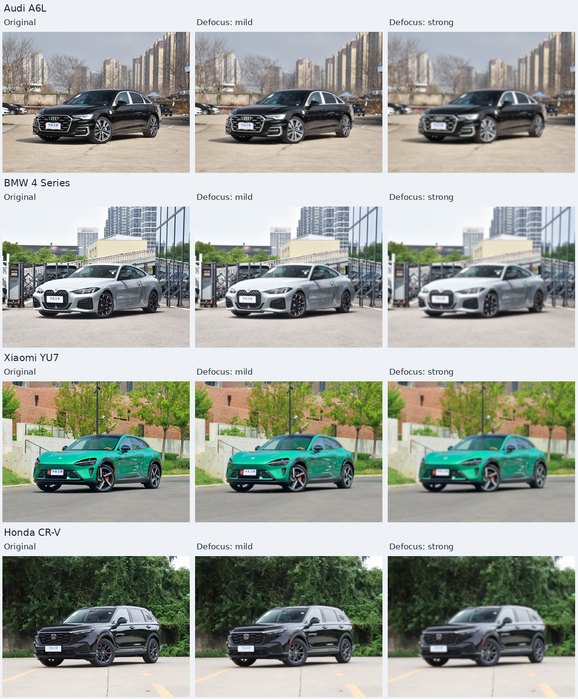
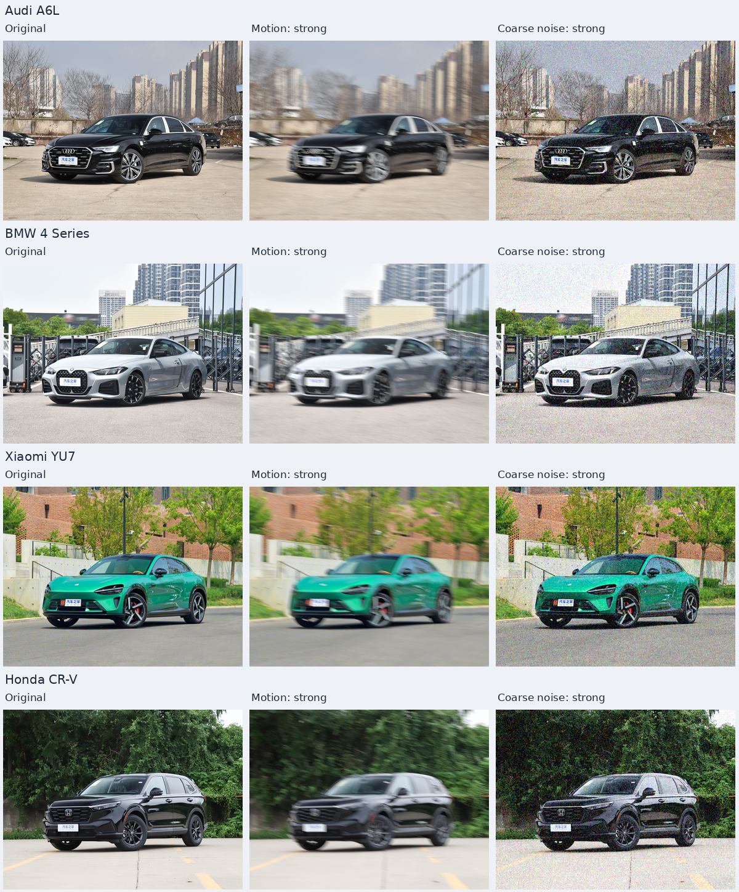
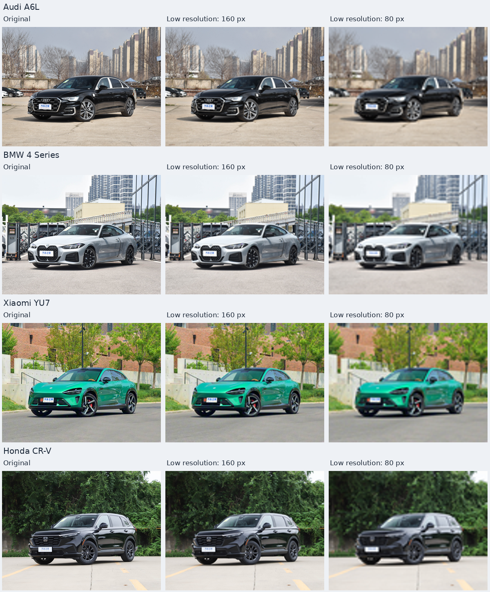
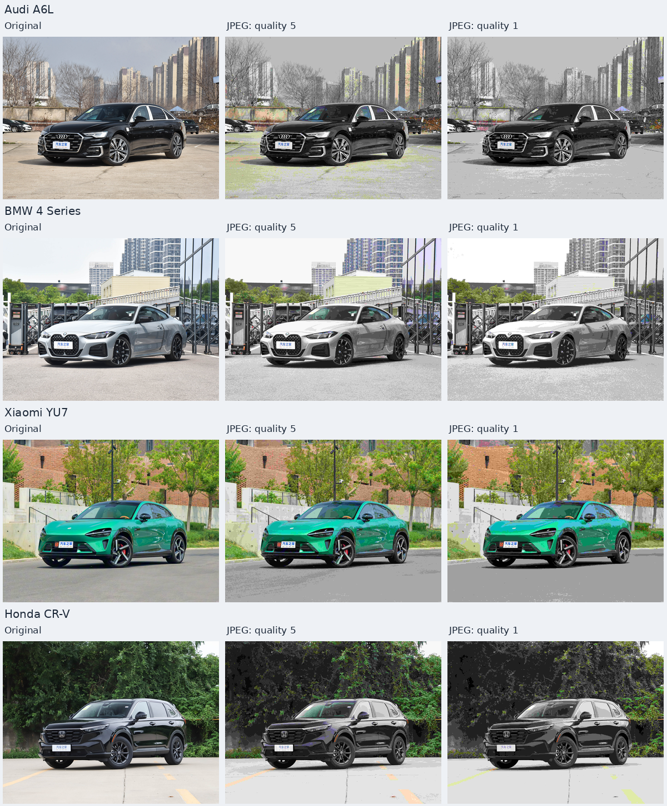
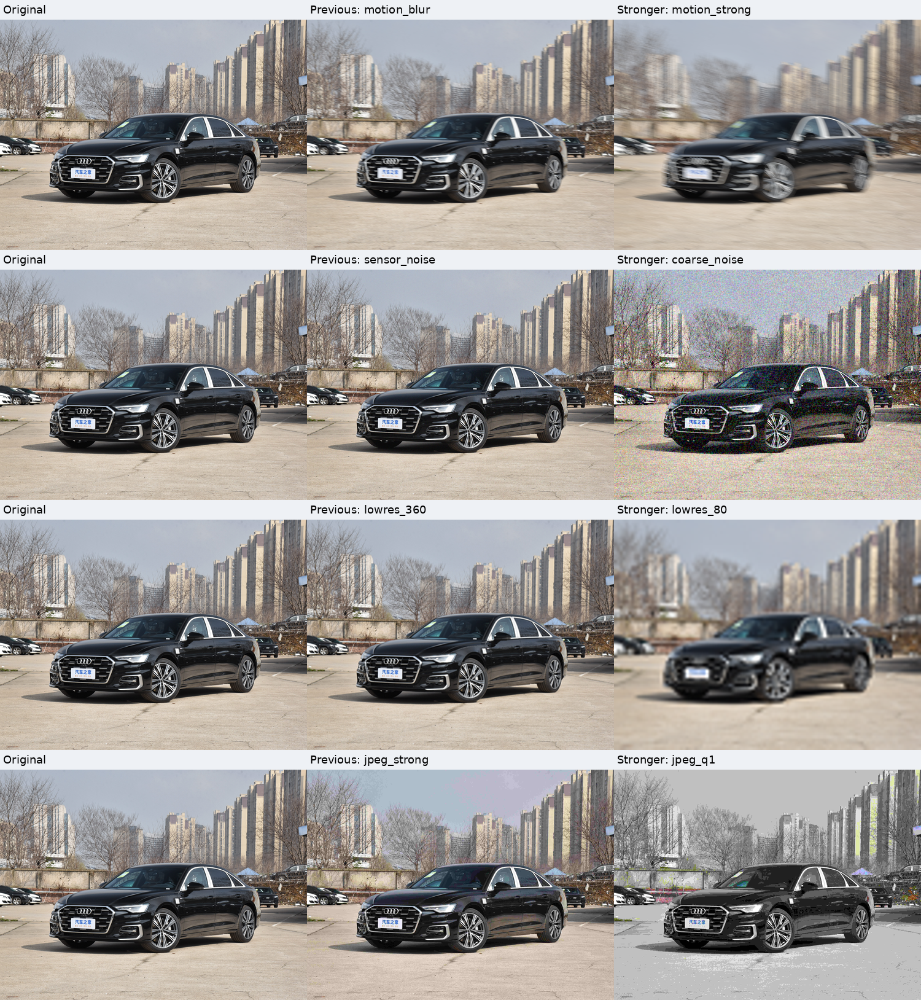
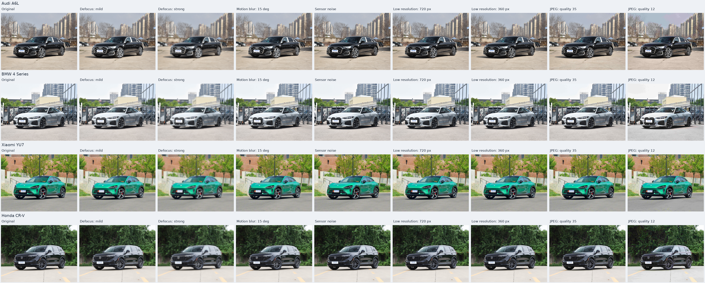
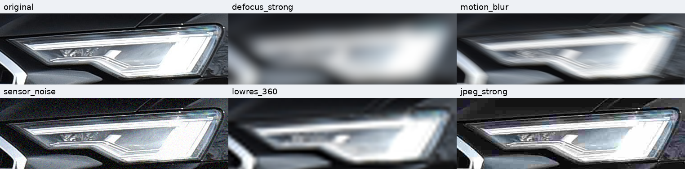

# 04 — 成像质量增强（清单方法 2）

[文档首页](README.md) · [项目首页](../README.md)

本模块实现增强清单中的第 2 项：模拟失焦、相机移动、噪声、较低有效分辨率及 JPEG 压缩造成的画质变化。项目目录按建立顺序命名为 `04_imaging_quality/`。使用 NumPy/Pillow 在 CPU 上运行，无需生成模型、模型权重或 GPU。

这些操作直接改变已有像素，不重新设计车辆零件，但会主动削弱甚至遮蔽灯带、格栅和轮毂等判别信息。样图用于检查退化强度和部件可辨程度，尚未完成分类训练或证明训练收益。

实现入口：[运行脚本](../04_imaging_quality/run.py) · [数值变换](../04_imaging_quality/quality/transforms.py) · [报告生成](../04_imaging_quality/quality/report.py) · [基础预设](../04_imaging_quality/configs/presets.json) · [强档预设](../04_imaging_quality/configs/strong_presets.json)。

## 当前强档：放大缩略图中的可见差异（2026-11-11）

基础组除失焦外，在整图展示中变化偏弱。原图短边为 2880，逐像素噪声和小压缩块经过缩小后会被平均；低分辨率短边 720／360 仍高于统一诊断的 224，因此再次缩小时大部分差异消失。当前新增 `--profile strong`，同时保留 `basic` 配置和 `quality_v1` 全部历史结果。

| 强档预设 ID | 基础组 | 强档参数与本批有效尺度 |
| --- | --- | --- |
| `defocus_mild` | 目标 σ=6 px | 保留原参数及实现 |
| `defocus_strong` | 目标 σ=12 px | 保留原参数及实现 |
| `motion_strong` | 当前原图长度 27 px | 参考短边 960 时长度 30、角度 15°；本批长度 90 px |
| `coarse_noise` | `peak=160`、`read_sigma=0.006`，逐像素独立噪声 | `peak=24`、`read_sigma=0.025`，随机残差网格短边 384，本批网格为 512×384 |
| `lowres_160` | 短边 720 | 实际小图 213×160，再恢复原尺寸 |
| `lowres_80` | 短边 360 | 实际小图 107×80，再恢复原尺寸 |
| `jpeg_q5` | JPEG quality 35 | 原尺寸 JPEG quality 5、4:2:0 |
| `jpeg_q1` | JPEG quality 12 | 原尺寸 JPEG quality 1、4:2:0 |

`peak` 越小，散粒噪声越强。新噪声先用 BILINEAR 在较小线性信号网格上估计噪声强度，生成 `Poisson(I_grid × peak) / peak + Gaussian(0, read_sigma) − I_grid` 随机残差，再用 BILINEAR 放大残差并加回原图线性信号。原图信号没有被缩小或放大；粗颗粒拥有空间相关性，在缩略图中更容易保留。它是图像空间颗粒近似，不能解读为某个真实 ISO 或完整相机成像管线。

四张原图、八种强档配置对应 32 张主图。强档目录为 `04_imaging_quality/outputs/quality_strong_v1/`，入口是[本地强档图库](../04_imaging_quality/outputs/quality_strong_v1/report/index.html)。两档 JPEG 仍在 3840×2880 原尺寸编码，改变的只有压缩参数，没有混入降分辨率。

为便于在页面内看清效果，当前展示分为四组，每行均为**原图＋两种增强**。每组从上到下是奥迪 A6L、宝马 4 系、小米 YU7、本田 CR-V。

**原图／轻度失焦／明显失焦**



**原图／强运动模糊／粗颗粒噪声**



**原图／短边 160／短边 80**



**原图／JPEG quality 5／JPEG quality 1**



[打开完整九列总览](assets/imaging-quality-strong-overview.png)。2026-11-12 调整了文档展示：从原 3600×1448 总览中按 400 像素列宽，分别取零基列 `[0,1,2]`、`[0,3,4]`、`[0,5,6]`、`[0,7,8]`，生成四张 1200×1448 PNG。仅重新排列已有预览列，不缩放或重采样其中的像素；每组保留原图、车型及效果标签，四车八种结果完整保留。文档新增图不计入原实验的 201 个 PNG，增强代码、参数及运行输出保持原样。

奥迪单车精选，四行三列：每行从左到右为**原图／上一版／本轮强档**；从上到下为**运动模糊 27→90 px、独立细噪声→粗颗粒噪声、低分辨率短边 360→80、JPEG quality 12→1**。拼图为 1500×1628，整图按相同比例缩放，未将各退化标定为相同感知强度。



[打开强度对比大图](assets/imaging-quality-strength-comparison.png)。完整图库还提供四部件原生像素裁剪和全图短边 224 后的对比，供检查颗粒、块效应和细节损失。JPEG quality 1 作为极强压力档，除了块效应还会出现明显色阶断裂、色偏或掉色。

### 强档实测结果

`quality_strong_v1` 已完成四车 32 张 3840×2880 主图，CPU 全流程耗时 **219.800 秒**；环境为 Python 3.10.12、NumPy 2.2.6、Pillow 12.1.0。**201 个 PNG 校验通过**，包括 32 张主图、144 张原生部件裁剪、17 张预览和 8 张实际低分辨率小图；另有 8 个真实 JPEG，解码像素逐一与对应主 PNG 完全一致。四张原图哈希未变，保留的两档失焦共 **8 张 PNG 与基础组逐字节一致**，代码快照哈希与当前实现一致。

**32 项测试通过**，耗时 9.460 秒：23 项变换性质、5 项管线、4 项报告测试。新增检查覆盖粗噪声在缩小后保留差异、残差空间相关性、缺省噪声兼容、强档配置和两档失焦保留。

以下比较四车平均绝对 RGB 码值差（MAE，0–255）。各值分别比较“原图与该档结果”，不是新旧增强图之间的直接差值；短边 224 结果先缩完整图，再计算指标。

| 对应退化：基础组 → 强档 | 基础组短边 224 MAE | 强档短边 224 MAE | 强档原尺寸 MAE |
| --- | ---: | ---: | ---: |
| 运动长度 27 → 90 px | 4.068 | 11.085 | 16.149 |
| 独立细噪声 → 粗颗粒噪声 | 1.101 | 10.485 | 15.572 |
| 低分辨率短边 720 → 160 | 0.130 | 5.477 | 12.019 |
| 低分辨率短边 360 → 80 | 0.515 | 10.740 | 15.822 |
| JPEG quality 35 → 5 | 1.016 | 6.318 | 9.931 |
| JPEG quality 12 → 1 | 3.031 | 8.458 | 13.076 |

已目视检查四车强档总览、本田短边 224 部件、奥迪原图／旧版／强档精选。加长运动拖影和粗颗粒在整图中也有明显变化；短边 80 比 160 损失更多细节；JPEG 5／1 的色阶断裂与灰化更明显。不同退化没有校准为相同感知强度。MAE 证实缩小后的差异增大，但不直接代表分类训练收益。

## 基础组八种预设（保留作历史对照）

四张共享原图均为 3840×2880。所有效果从未增强原图独立生成，不串联上一张结果，也不叠加光照或天气变化。

| 预设 ID | 处理 | 本轮配置及有效尺度 |
| --- | --- | --- |
| `defocus_mild` | 轻度失焦 | 参考短边 960 时目标 σ=2；本轮目标 σ=6，近似核实际 σ≈5.831 像素 |
| `defocus_strong` | 明显失焦 | 参考短边 960 时目标 σ=4；本轮目标 σ=12，近似核实际 σ≈11.832 像素 |
| `motion_blur` | 方向性运动模糊 | 参考短边 960 时长度 9、角度 15°；本轮长度约 27 像素 |
| `sensor_noise` | 信号相关噪声和读出噪声近似 | 近似线性 RGB 中 Poisson `peak=160`，Gaussian `read_sigma=0.006` |
| `lowres_720` | 降低有效分辨率 | 缩至 960×720，再恢复为 3840×2880 |
| `lowres_360` | 更低有效分辨率 | 缩至 480×360，再恢复为 3840×2880 |
| `jpeg_medium` | 中度 JPEG 压缩 | 原尺寸编码，Pillow `quality=35`，4:2:0 色度抽样 |
| `jpeg_strong` | 强 JPEG 压缩 | 原尺寸编码，Pillow `quality=12`，4:2:0 色度抽样 |

两组的强度标签是实验对照名称，没有按真实设备、焦距、ISO 或快门速度标定。Gaussian 失焦以三次可分离盒滤波近似，不模拟真实镜头的空间变化散焦圆；运动模糊假定整幅画面具有统一方向，不包含滚动快门、景深差异或主体独立运动。

## 如何构建

### 模糊与噪声

输入先按 EXIF 校正方向并转换为 RGB。模糊和噪声在由 sRGB 解码得到的近似线性 RGB 中计算，再裁切至显示范围、编码回 sRGB，保存为 8-bit PNG。原图已经经过相机处理和 JPEG 编码，这一解码不能恢复 RAW 数据。

模糊使用归一化的中心对称核，边缘反射扩展；参考短边决定有效像素尺度，避免同一参数用于不同分辨率时强度相差过大。失焦通过三次可分离盒滤波近似 Gaussian，本轮轻／强两档盒宽分别为 `[11,11,13]`、`[23,23,25]`，清单同时记录目标 σ 和实际核的 σ。运动核用双线性亚像素权重离散居中的均匀线段，只扩散已有内容，不通过整体平移制造变化；15° 按图像坐标向右、向下的方向定义。

噪声采用 `Poisson(I × peak) / peak + Gaussian(0, read_sigma)`，其中 `I` 为近似线性 RGB。它提供随信号变化的随机扰动和额外读出项；没有模拟完整 Bayer 采样、去马赛克、相机降噪或真实传感器相关噪声，因此不能将 `peak` 直接解释为 ISO。记录显示范围外的截断情况，避免把所有变化都归因于可逆噪声。

默认基础种子为 42。实际每张图的种子由基础种子、原图 SHA256 和预设 ID 稳定派生；增删其他图片、改变遍历顺序或仅运行一个预设，不应改变该图的噪声结果。运行清单记录实际种子、依赖版本和实现快照。

### 低分辨率

先用 LANCZOS 缩至指定短边，再用 BICUBIC 恢复到原图尺寸，保持构图和部件坐标，便于同坐标对照。恢复像素数量不恢复被丢弃的细节；同时保存真正的低分辨率小图，便于核查有效尺寸和后续处理。对于短边已经小于目标值的输入，不执行无意义的预先放大。

### JPEG 压缩

在原始分辨率执行实际 JPEG 编码，保存编码字节流，再解码为 PNG 作为统一对照图。PNG 与对应 JPEG 的解码像素应完全一致；PNG 不是第二次 JPEG 压缩，也不代表压缩损伤已恢复。

basic 与 strong 中的 JPEG 预设均不缩小图像。原图本身也是 JPEG，因此这是从现有 JPEG 解码图再次编码的实验，不能等同于从无损相机 RAW 的首次编码。`quality` 依赖编码器实现，不是百分比保真度，也不保证所有图片产生同一文件大小。

如后续增加“低分辨率 + JPEG”传输链路，应单独命名并提供同分辨率无 JPEG 对照，不能把混合变化全部归因于压缩。

## 运行方法

从项目根目录执行，Python 3.10+；可复用物理天气／光照模块的 NumPy/Pillow 环境。以下命令选择当前强档；不传 `--profile` 时仍默认 basic，便于复现旧结果。

```bash
python -m pip install -r 04_imaging_quality/requirements.txt

python 04_imaging_quality/run.py \
  --profile strong \
  --output-dir 04_imaging_quality/outputs/quality_strong_new_run \
  --check-config

python 04_imaging_quality/run.py \
  --profile strong \
  --output-dir 04_imaging_quality/outputs/quality_strong_new_run

python -m unittest discover -s 04_imaging_quality/tests -v
```

仅比较部分退化：

```bash
python 04_imaging_quality/run.py \
  --profile strong \
  --effects motion_strong coarse_noise jpeg_q1 \
  --seed 42 \
  --output-dir 04_imaging_quality/outputs/quality_subset
```

| 参数 | 含义 |
| --- | --- |
| `--profile` | `basic`（默认）或 `strong`；决定预设和默认输出目录 |
| `--input-dir` | 原图目录，默认项目的 `test_images/` |
| `--presets` | 可选自定义 JSON，优先于 profile；basic 默认 `configs/presets.json`，strong 默认 `configs/strong_presets.json` |
| `--scenes` | 场景／部件配置，默认共享 `01_physics_based/configs/scenes.json` |
| `--effects` | 仅运行指定预设 ID，不传则运行全部八种 |
| `--seed` | 基础随机种子，默认 42，范围 `[0, 2**32)`；实际噪声种子写入清单 |
| `--output-dir` | 必须不存在或为空的新目录，禁止写入输入与模型目录；默认 basic 为 `outputs/quality_v1`，strong 为 `outputs/quality_strong_v1` |
| `--check-config` | 只检查配置、输入和输出路径，不生成图片 |

新增图片时，需在场景 JSON 中添加同名条目和 `regions`。部件框基于 EXIF 方向校正后的图像、归一化到 `[0,1]`；默认查看车灯、格栅、前轮、后轮。框与车辆轮廓只用于裁剪或统计，不限制模糊、噪声和压缩的作用范围。

### 换成自己的图片

增强核心 `apply_quality(rgb, preset, seed)` 接收任意非空 `uint8` RGB 数组，不依赖这四张样例的文件名、车型或固定分辨率；同样可以处理其他车型、机位和非车辆图片。样例中的车型名只用于输出命名，部件框只用于对比和统计，没有参与成像质量变换。

**保留批处理和报告时**，替换 `--input-dir`，并为目录内每张图片提供同名场景条目。暂时只看整图时不必标注车灯、格栅或轮毂，可用全图区域。例如 `my_images/photo.jpg` 对应的 `my_scenes.json`：

```json
{
  "photo.jpg": {
    "label": "My photo",
    "regions": {"full_image": [0, 0, 1, 1]}
  }
}
```

```bash
python 04_imaging_quality/run.py \
  --profile strong \
  --input-dir my_images \
  --scenes my_scenes.json \
  --output-dir 04_imaging_quality/outputs/my_images_run
```

当前入口读取输入目录的直接子文件，不递归扫描分类子目录。需要真正的关键部件报告时，再把 `full_image` 替换为该图片的部件框；不能直接复用样例框的位置。

已用两个不在样例配置中的文件名、257×385 与 403×269 的测试输入验证上述整图模式：不提供车型标签或车辆轮廓，八种强档均可运行，共生成 16 张结果，保持各自输入尺寸和源文件不变。

**只要增强像素、不需要报告时**，直接调用核心函数，无需 `scenes` 或任何区域标注。以下示例从项目根目录运行，将运动模糊参考长度改为 18：

```python
import json
from pathlib import Path
import sys

import numpy as np
from PIL import Image, ImageOps

sys.path.insert(0, str(Path("04_imaging_quality").resolve()))
from quality import apply_quality

presets = json.loads(Path("04_imaging_quality/configs/strong_presets.json").read_text())
preset = {**presets["motion_strong"], "length": 18.0}
with Image.open("my_images/photo.jpg") as source:
    rgb = np.asarray(ImageOps.exif_transpose(source).convert("RGB"))
result = apply_quality(rgb, preset, seed=42)
Image.fromarray(result.image).save("photo_motion.png")
```

模糊参数按输入短边与 `reference_short_edge` 的比例自动换算：示例长度 18 在短边 960 的图上是 18 像素，在短边 2880 的图上是 54 像素。低分辨率的 `short_edge` 和粗颗粒的 `grain_short_edge` 是绝对目标尺寸；输入已经更小时不再执行该缩小步骤。JPEG `quality` 直接控制编码器。同一套参数可复用，但具体可见强度仍受原图细节、分辨率及最终显示／训练尺寸影响。可复制预设 JSON 调整参数，再通过 `--presets` 传入，不必修改算法。

## 基础组图片与通用查看方式

首轮目录为 `04_imaging_quality/outputs/quality_v1/`，入口是 [本地 HTML 图库](../04_imaging_quality/outputs/quality_v1/report/index.html)。完整输出不纳入 Git；克隆项目后需自行生成。精选总览随文档保存，可直接在 GitHub 浏览：



[打开无损总览](assets/imaging-quality-overview.png)。从上到下为奥迪 A6L、宝马 4 系、小米 YU7、本田 CR-V；从左到右为原图、轻度失焦、明显失焦、运动模糊、噪声、短边 720、短边 360、JPEG 35、JPEG 12。

下面是奥迪车灯的精选原生裁剪；各单元使用相同坐标，部件像素不缩放。仅展示部分预设，上排依次为**原图、明显失焦、运动模糊**，下排为**传感器噪声、短边 360、JPEG quality 12**。整张拼图为 1524×378，网页显示时可能缩小，点击图片可查看原尺寸。



[打开车灯原生对比](assets/imaging-quality-headlamp.png)。目视检查可见：明显失焦抹除灯内细节，运动模糊产生方向拖影，噪声形成彩色颗粒，短边 360 损失灯组内部结构，JPEG 12 在暗区及边缘出现块效应和阶梯。它们保留原图构图，但局部可辨信息已发生损失。这张精选不能替代四车、四部件、全部八种效果的检查。

报告包含三种查看尺度：

- **整图与分组预览**：观察模糊、噪声、分辨率和压缩各组的总体变化。
- **原生部件裁剪**：原图与所有输出使用完全相同的像素框，保存无损 PNG；适合查看灯带细节、格栅边缘、轮毂线条和压缩块。
- **短边 224 诊断**：先将完整图缩至短边 224，再裁相应部件，以最近邻放大用于查看。它展示输入缩小时的信息变化，不是先裁部件再缩放，也不是生成式超分。

所有新报告拼图采用 PNG。JPEG 拼图会给对照原图额外引入压缩误差，尤其影响本方法对噪声和块效应的观察。PNG 拼图仍可能经过尺寸缩放；核查原生差异时应点击原尺寸裁剪，而不是仅看网页缩略图。

## 输出、指标与复现

四车全预设运行生成 32 张统一原尺寸主 PNG；同时保存 8 张实际低分辨率小 PNG 和 8 个 JPEG 编码文件。报告包含 144 张原生部件裁剪（四车 × 四部件 × 原图与八效果）以及 17 张 PNG 预览（总览、四组总览、每车整图／部件／224 诊断）。

| 路径 | 内容 |
| --- | --- |
| `images/` | 32 张原尺寸 PNG，含 JPEG 的无损解码结果 |
| `encoded/` | 8 个实际编码 JPEG，可核查文件大小 |
| `native/` | 8 张真实低分辨率 PNG，不经过恢复尺寸步骤 |
| `crops/` | 原图与结果的同坐标原生部件 PNG |
| `previews/` / `report/index.html` | 无损 PNG 拼图／HTML 图库 |
| `manifest.json` / `verification.json` | 参数、哈希、诊断和运行状态／文件检查 |
| `config_snapshot/` / `code_snapshot/` | 本次所用配置／实现代码 |

运行清单保存原图和输出哈希、原图尺寸、实际生效的退化参数、种子、依赖版本、耗时及代码／配置快照。不同预设分别记录有效模糊尺度、低分辨率尺寸或 JPEG 编码参数和文件大小。

诊断比较原图与结果的码值差异、PSNR 和梯度变化，并区分原尺寸及短边 224 结果。PSNR 越低说明像素差异越大，不自动等价于训练效果越好；噪声可以提高梯度，因此梯度统计不能命名为“清晰度得分”。车辆及部件指标也不是自动合格判定。

## 首轮实测记录（2026-11-10）

`quality_v1` 已完成，CPU 全流程耗时 **218.660 秒**；环境为 Python 3.10.12、NumPy 2.2.6、Pillow 12.1.0。生成 32 张 3840×2880 主图、144 张原生部件裁剪、17 张预览和 8 张实际小图，共 **201 个 PNG 校验通过**；另有 8 个实际 JPEG，逐一核对解码像素与对应主 PNG 完全一致。四张原图的 SHA256 未变化。完整 27 项测试通过，覆盖变换性质、随机复现、输入保护、JPEG 一致性、管线输出及报告裁剪／链接。

以下为四车平均绝对 RGB 码值差（MAE，0–255 尺度），原图和增强结果在每个尺度分别比较；不是分类性能或保真合格率。

| 预设 | 原尺寸 MAE | 整图短边 224 后 MAE |
| --- | ---: | ---: |
| 轻度失焦 | 10.947 | 4.767 |
| 明显失焦 | 15.135 | 9.526 |
| 运动模糊 | 9.806 | 4.068 |
| 传感器噪声 | 8.727 | 1.101 |
| 短边 720 | 4.760 | 0.130 |
| 短边 360 | 7.876 | 0.515 |
| JPEG quality 35 | 2.768 | 1.016 |
| JPEG quality 12 | 5.741 | 3.031 |

已目视检查四车整图总览、四车格栅、奥迪原生车灯及奥迪短边 224 诊断。失焦、运动方向、颗粒与压缩损伤在局部对照中可见；此检查没有将所有样本判定为适合训练。尤其短边 720／360 的变化在再次缩至 224 时大部分消失，噪声也明显衰减，不能仅依据原尺寸差异宣称训练增强有力。本次 strong 组已据此降低有效分辨率并增大噪声颗粒尺度；正式训练时仍应使用分类器的实际输入尺寸与预处理流程校准。

本轮代码、文档和精选图暂保留本地供审图；上一轮光照与改进眩光已推送 GitHub，见交接记录。`complete_pending_visual_review` 是生成器完成文件检查后的状态，不是正式训练数据验收结论。

## 当前边界和下一步

基础组的细噪声和小 JPEG 块在缩略图中容易被平均。strong 组通过增大颗粒尺度、减少有效像素和加重实际压缩来提高可见差异；全图短边 224 的结果仍需与原生裁剪一起检查，避免用局部放大代替实际训练输入效果。

先根据原生部件和实际训练输入尺度选出可辨性仍足够的强度，再考虑多级随机采样或组合“轻模糊 + 噪声 + 压缩”。过强样本可作为压力测试候选，不必全部加入训练。若后续接入数据集，必须按原始照片及同次拍摄组划分集合，使同一原图的所有衍生版本留在同一集合；最终收益需要在独立真实设备／传输条件的测试集上验证。
