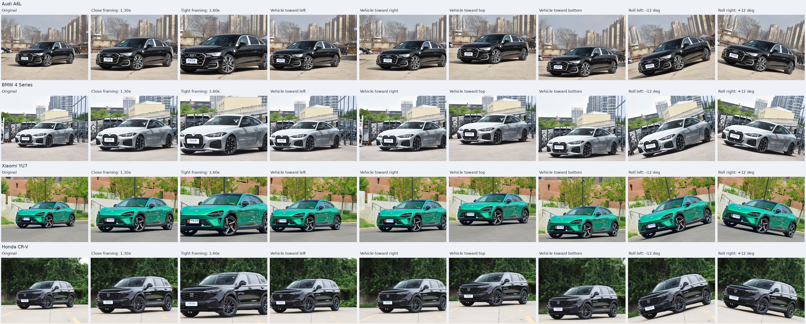
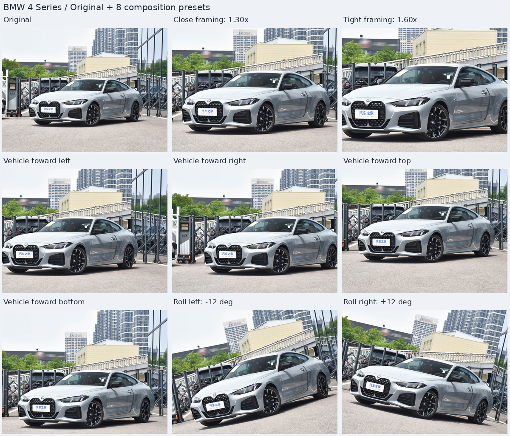
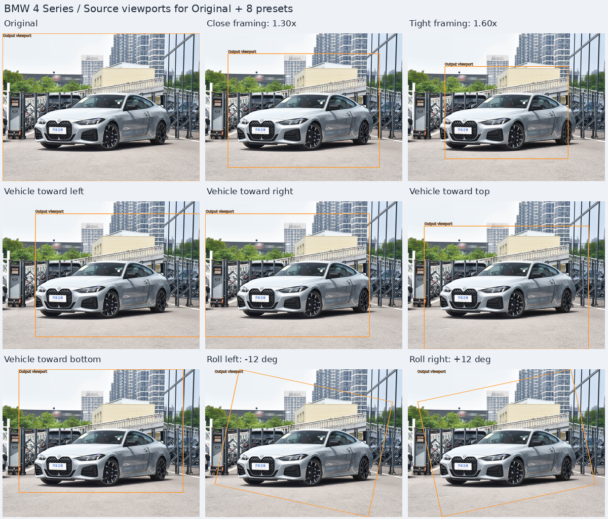
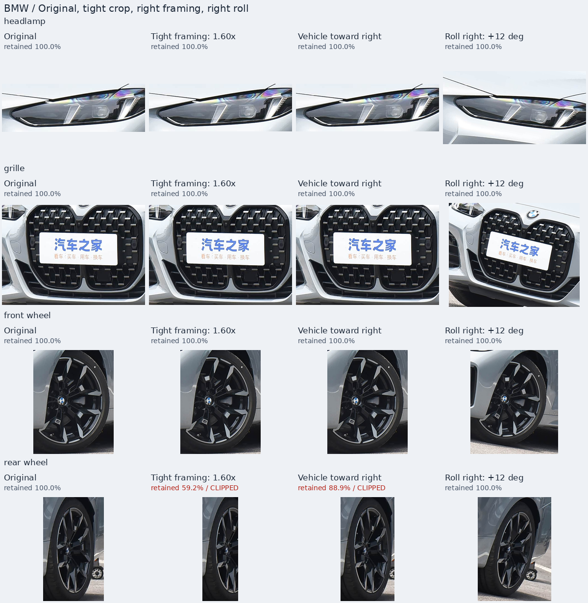

# 05 — 构图与尺度增强（清单方法 3）

[文档首页](README.md) · [项目首页](../README.md)

本模块实现增强清单中的第 3 项：改变车辆在画面中的占比、位置、取景范围和画面倾斜。使用现有四张原图，每张独立应用八种预设，形成 32 张候选样图。实现依赖 NumPy/Pillow，在 CPU 上运行，无需大模型、模型权重或 GPU。

实现入口：[运行脚本](../05_composition_scale/run.py) · [几何变换与标注映射](../05_composition_scale/composition/transforms.py) · [对比报告](../05_composition_scale/composition/report.py) · [八种预设](../05_composition_scale/configs/presets.json)。

## 八种明显变化

现有四辆车的主体框宽度约占原图的 68.0%–68.9%。首轮直接以可见的车辆占比、中心位移和旋转角度定义强度，避免只做很小的随机抖动。

| 预设 ID | 变换 | 本轮设置与观察目标 |
| --- | --- | --- |
| `zoom_close` | 近景放大 | 1.30 倍，车宽占比约 88%–90%，目标保留整车 |
| `zoom_tight` | 紧裁剪放大 | 1.60 倍，未截断主体框宽度约 109%–110%，允许部分首尾出框 |
| `position_left` | 车辆靠左 | 1.20 倍裁剪，取景窗口靠原图右侧，车辆中心约在画宽 40% |
| `position_right` | 车辆靠右 | 1.20 倍裁剪，取景窗口靠原图左侧，车辆中心约在画宽 60% |
| `position_up` | 车辆靠上 | 1.20 倍裁剪，取景窗口靠原图下侧，车辆中心向上移动约 8%–9% 画高 |
| `position_down` | 车辆靠下 | 1.20 倍裁剪，取景窗口靠原图上侧，车辆中心向下移动约 11%–12% 画高 |
| `roll_left` | 画面左倾 | −12°，自动计算消除空角所需的等比放大，本批约 1.257 倍 |
| `roll_right` | 画面右倾 | +12°，自动计算消除空角所需的等比放大，本批约 1.257 倍 |

左右位置预设允许少量主体截边；`zoom_tight` 明确属于检测框过紧的截断压力档。`zoom_close`、上下位置和倾斜预设以保留主体为目标。每张图片的实际几何指标和可见比例写入运行清单，不能仅凭预设名称认定所有部件都完整。

配置中的 `retention_policy` 分为 `complete` 和 `partial_allowed`。已提供车辆多边形时，完整主体预设会在生成前检查几何保留率，不满足完整要求则明确报错，不自动降低强度或改成截断档。未提供主体多边形时只记录该检查不可用，不作整车完整性的保证。

输出仍为原图画布尺寸，本批为 3840×2880。所有效果独立作用于原图，不串联其他构图、光照或成像质量结果。画面倾斜是二维旋转，取景变化不产生新的真实机位、侧面或车尾视角。

## 首轮实测（2026-11-11）

`composition_v1` 已完成四车 32 张 3840×2880 主图，CPU 全流程耗时 **149.836 秒**；环境为 Python 3.10.12、NumPy 2.2.6、Pillow 12.1.0。共 **233 个 PNG 校验通过**：32 张主图、32 张有效像素 mask、144 张原生部件裁剪和 25 张预览。本批无完全出框部件；32 张 mask 全部有效，四张原图的 SHA256 未变化，当前生产代码哈希与运行快照一致。

另外逐一核对了 144 张原生部件裁剪：像素与对应主图在变换后可见框中的裁剪完全相同；图库的 232 个本地链接全部有效。

**27 项测试通过**，耗时 12.157 秒，包括 16 项几何核心、5 项管线和 6 项报告测试。覆盖正逆矩阵、像素中心和旋转方向、无空角、裁剪可见性、输入保护、变换后部件对应及报告链接。

以下范围来自四车实际输出。中心位移相对原图车辆框中心计算；“未截断框宽度”是完整映射后的框宽除以画宽，允许超过 100%；主体保留率以车辆多边形面积计算。

| 预设 | 实际几何变化 | 主体保留率 |
| --- | --- | --- |
| 近景 `zoom_close` | 1.30 倍；车框宽度占比 88.400%–89.570% | 100% |
| 紧裁剪 `zoom_tight` | 1.60 倍；未截断框宽度占比 108.800%–110.240% | 94.750%–95.855% |
| 左偏 `position_left` | 中心横向位移 −9.98% 至 −9.83% 画宽 | 99.805%–99.959% |
| 右偏 `position_right` | 中心横向位移 +10.02% 至 +10.17% 画宽 | 98.501%–99.607% |
| 上偏 `position_up` | 中心纵向位移 −8.49% 至 −8.01% 画高 | 100% |
| 下偏 `position_down` | 中心纵向位移 +11.51% 至 +11.99% 画高 | 100% |
| 左／右倾斜 | −12°／+12°；实际等比倍率 1.257109 | 100% |

紧裁剪保留了约 95% 的主体多边形，但某些关键部件损失更大：四车后轮区域最低保留 **57.112%**；右偏后轮最低保留 **77.395%**。主体面积接近完整不能替代部件检查。上下偏置与左右倾斜的主体及全部四个部件区域均保留 100%。

已目视检查四车总览、宝马全部原生部件及精选整图／取景框／部件图。车辆占比、位置和倾斜变化明显，车身各轴按同一比例变换；紧裁剪与右偏造成的后轮区域损失也清楚可见。文件校验和几何比例不等于分类训练收益，完整样本与截断压力样本仍应分别评估。

## 图像和坐标如何一起变换

### 一次重采样

输入按 EXIF 校正方向并转换为 RGB。缩放、平移和旋转先组合成一个 3×3 正向仿射矩阵，再用逆矩阵执行一次 BICUBIC 重采样。这样避免连续缩放、裁剪、旋转重复插值。各轴使用一致尺度，保持车身比例。

放大以车辆轮廓外接框中心为锚点，锚点在输出画面中的位置保持不变；未提供轮廓时使用图像中心。位置变化通过原图内部的裁剪窗口实现，窗口以外的原像素被舍弃。旋转围绕画面中心，并根据角度和宽高比计算覆盖画布的最小等比倍率，保留微小采样安全余量；实际倍率记录在清单中。本批 3840×2880 的 ±12° 旋转，几何覆盖下限约为 1.255363；加入 2 像素安全边距后的实际倍率为 1.257109。

本轮只使用原图可用像素，不做生成式背景扩展、镜像或反射补边。车辆缩小后的自然远景需要额外背景来源，未包含在这八种预设中。

### 标注跟随同一矩阵

几何坐标采用像素边界 `[0,W]×[0,H]`，像素中心为半整数。原图的车辆多边形和每个部件矩形的四个角，都用与图像相同的正向矩阵映射到输出。旋转后的部件区域是四边形，不再假设仍与坐标轴平行。

报告将映射后的多边形裁到输出画布范围，记录完整映射区域、实际可见区域、可见外接框和保留比例。原生部件 PNG 从输出中的可见外接框直接裁取，坐标按左／上取 floor、右／下取 ceil 并限制在画布内。它们是输出像素的真实裁剪，没有反向旋转或超分恢复；旋转框的外接矩形可能包含额外背景。

被裁掉的部分不会补画。若某个部件完全出框，预览和 HTML 标为不可见，不创建假部件裁剪。部分出框时显示保留比例，裁剪尺寸也可能变小。

短边 224 诊断先缩小完整输出，再按映射后的可见区域同步缩放坐标并裁剪，使用最近邻放大便于观察。它用于检查实际缩图后的构图与部件可见性，不是已建立分类器的准确率评估。

## 运行方法

从项目根目录执行，Python 3.10+；可复用之前 NumPy/Pillow 的 CPU 环境。

```bash
python -m pip install -r 05_composition_scale/requirements.txt

python 05_composition_scale/run.py \
  --output-dir 05_composition_scale/outputs/composition_new_run \
  --check-config

python 05_composition_scale/run.py \
  --output-dir 05_composition_scale/outputs/composition_new_run

python -m unittest discover -s 05_composition_scale/tests -v
```

只生成部分构图：

```bash
python 05_composition_scale/run.py \
  --effects zoom_close zoom_tight position_left roll_right \
  --output-dir 05_composition_scale/outputs/composition_subset
```

| 参数 | 含义 |
| --- | --- |
| `--input-dir` | 原图目录，默认项目的 `test_images/` |
| `--output-dir` | 新运行目录，默认 `05_composition_scale/outputs/composition_v1`；须不存在或为空 |
| `--presets` | 预设 JSON，默认本模块的 `configs/presets.json` |
| `--scenes` | 图片同名场景与部件配置，默认共享 `01_physics_based/configs/scenes.json` |
| `--effects` | 仅运行指定预设 ID，不传时运行全部八种 |
| `--check-config` | 预检输入、参数、几何和输出目录，不生成图片 |

本轮变换由输入和参数确定，不需要随机种子。需要不同强度时复制预设 JSON 调整 `scale`、`angle` 或 `direction`，通过 `--presets` 指定新配置。输出目录不能位于输入或模型目录内，也不能覆盖已有运行结果。

## 换成其他图片

核心变换不依赖样例文件名或车型，可处理其他尺寸、横竖构图的 RGB 图片。无车辆多边形时，放大使用图像中心；提供 `subject_polygon` 后，才可按车辆位置选择放大锚点并统计主体保留情况。

现有批处理入口还负责对比报告，因此每张输入需要同名场景条目和 `regions`。要比较车灯、格栅、前轮和后轮，应提供新图自己的归一化框；只看整图可用 `full_image: [0,0,1,1]`。整图框不能代替车辆轮廓，未标注主体时不能据此声称车辆完整保留。

模糊或噪声方法可以在固定坐标直接裁对照；构图方法必须按变换后的坐标裁对应部件。本模块把这一步包含在输出清单和报告中，换图时无需手动重新推算每张增强图的部件位置。

## 查看整图、取景框和部件

首轮目录为 `05_composition_scale/outputs/composition_v1/`，入口是[本地 HTML 图库](../05_composition_scale/outputs/composition_v1/report/index.html)。完整输出由 Git 忽略，克隆项目后需要运行生成；下面的精选 PNG 随文档保存。



从上到下为奥迪 A6L、宝马 4 系、小米 YU7、本田 CR-V；从左到右为**原图、近景 1.30 倍、紧裁剪 1.60 倍、左偏、右偏、上偏、下偏、左倾 −12°、右倾 +12°**。[打开整图总览](assets/composition-scale-overview.png)。

下面是宝马的三行三列精选，方便看清单车变化。按从左到右、从上到下的顺序为**原图、近景、紧裁剪、左偏、右偏、上偏、下偏、左倾、右倾**：



[打开单车九宫格](assets/composition-scale-example.png)。这是正式整图预览单元的重排，图像保持相同展示尺度。

<details>
<summary>查看同一顺序的原图取景框</summary>



[打开取景框示意](assets/composition-scale-framing.png)。这张精选也是宝马三行三列，顺序与上面的单车图一致；每格显示同一原图，橙色取景框来自输出四角通过逆矩阵映射回原图，表示本次输出实际取自原图的范围，旋转预设对应倾斜四边形。诊断图中的线框仅用于解释取景，不写入增强主图。

</details>

下面的宝马部件精选按列为**原图、紧裁剪 1.60 倍、右偏、右倾 +12°**，按行为**车灯、格栅、前轮、后轮**：



[打开部件精选](assets/composition-scale-parts.png)。宝马紧裁剪的后轮区域保留约 59.2%，右偏约 88.9%，标签同时显示保留率。部件已跟随变换定位，裁剪后又按比例适配展示格子，所以单纯放大或平移的完整部件可能看起来相近；尺度与位移以整图判断，结构与截断情况结合原生裁剪和保留率判断。

报告同时提供完整输出、映射后的部件标注预览、可见部件原生裁剪，以及短边 224 的对应部件对照。部件格子显示几何保留率，部分截断标为红色 `CLIPPED`，完全出框标为 `OUT OF FRAME`。部件拼图会按展示格子缩放；核查原生细节时使用 HTML 中的原尺寸 PNG 链接。

## 输出与几何诊断

四车八预设对应 32 张主图和 32 张有效像素 mask。本轮四车的四个部件均有可见区域，生成 144 张原生裁剪；其他图片若有部件完全出框，实际裁剪数量会减少。25 张预览包含整图总览、四个分组总览和每车五种诊断：整图、部件、224 部件、原图取景框、输出部件标注。

| 路径 | 内容 |
| --- | --- |
| `images/` | 原尺寸增强 PNG，不绘制标注线 |
| `masks/` | 对应有效像素 mask，用于检查输出像素是否有原图来源 |
| `crops/` | 变换后可见部件的原生 PNG 裁剪 |
| `previews/` | 无损 PNG 拼图与诊断图 |
| `report/index.html` | 本地 HTML 图库 |
| `manifest.json` / `verification.json` | 参数、矩阵、几何诊断、哈希与文件检查 |
| `crop_regions.json` | 原图及各变换后部件的位置、可见区域和裁剪坐标 |
| `config_snapshot/` / `code_snapshot/` | 本次使用的配置与实现快照 |

判断变化是否足够明显，主要看车辆中心位移、车辆框宽高占比、实际等比倍率和旋转角，而不把几何错位后的 MAE 当作主要标准。主体及部件的保留率是映射区域与画布相交后的面积比例；部件矩形中可能包含背景，因此不是车型信息保留率。有效像素 mask 表示来源有效性，也不代表车辆或关键部件完整。

完整主体预设与允许截断预设分开记录。取景可以明显变化而不合成新车辆结构，但强裁剪仍会丢失判别信息。首轮用于选择构图和强度，尚未验证分类训练收益；后续训练仍需按原始照片及拍摄组划分集合，避免同一源图的衍生样本跨集合。
