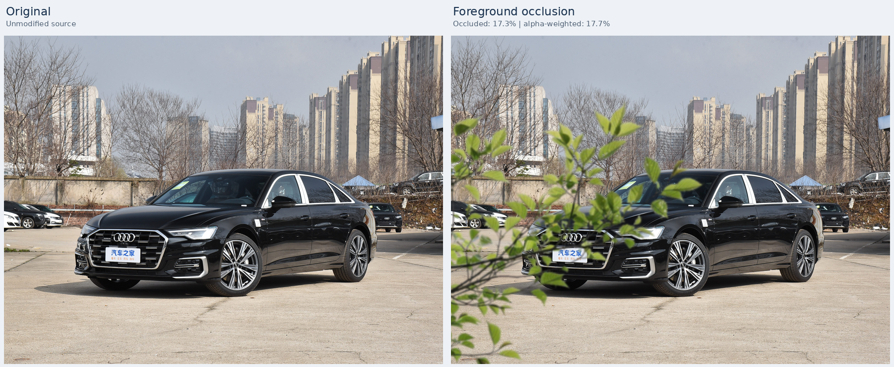
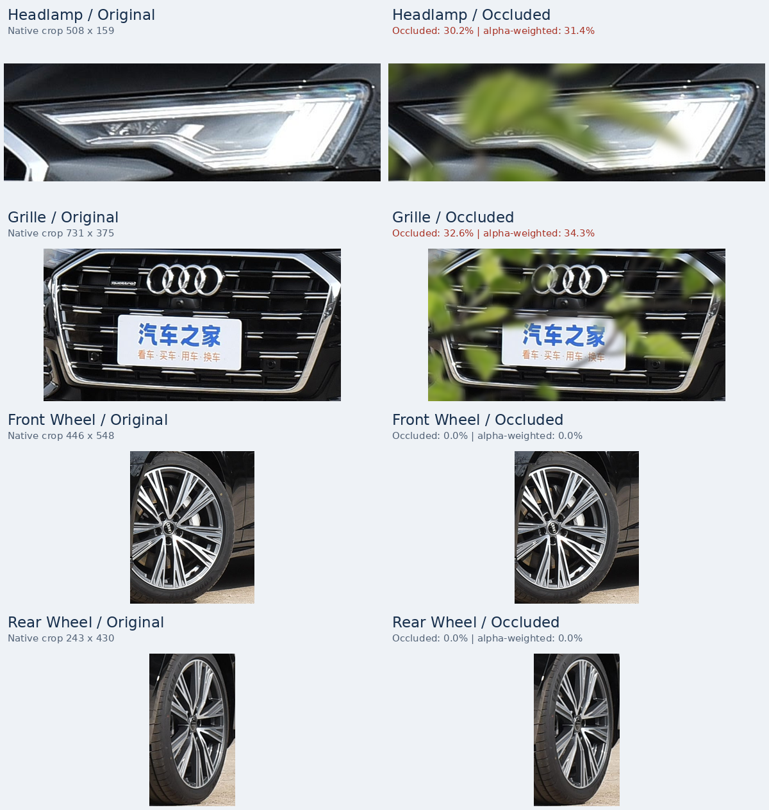
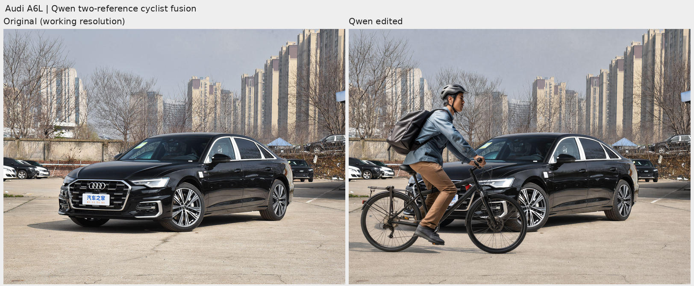
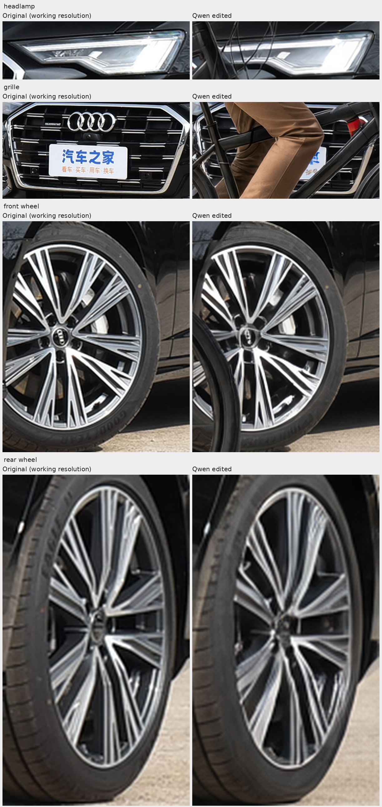
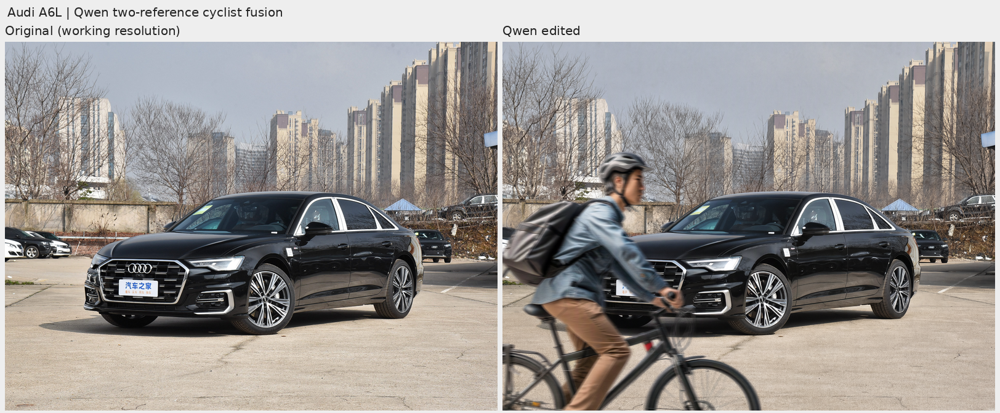

# 06 — 局部遮挡增强（清单方法 5）

[文档首页](README.md) · [项目首页](../README.md)

本模块默认使用通用 RGBA 前景合成：将准备好的枝叶、人物等素材按配置摆放在目标图像前方，统计车辆和部件的遮挡比例，并生成可核查的整图与部件报告。这一路径使用 CPU NumPy/Pillow，无需大模型、模型权重或 GPU；另有独立的[本地 Qwen 双参考融合入口](#本地-qwen-双参考融合)，由模型处理素材与车辆场景的融合。

CPU 首轮使用用户提供的枝叶素材，生成 **一张奥迪 A6L 遮挡演示**。杆柱、护栏、枝叶、行人四类两档的 32 张批次仍属于后续方案，当前未实现专用类别绘制或自动摆放。下方 CPU 参数、遮挡率和 29 项测试均属于这一路径，不作为 Qwen 生成效果的验证。

实现入口：[单图运行脚本](../06_local_occlusion/run.py) · [合成与可见性统计](../06_local_occlusion/occlusion/core.py) · [素材准备](../06_local_occlusion/occlusion/material.py) · [报告](../06_local_occlusion/occlusion/report.py) · [演示配置](../06_local_occlusion/configs/branches_demo.json)。

## 素材准备：棋盘图案不等于透明通道

用户上传的枝叶图为 **1000×707 RGB**，没有 alpha 通道，白灰棋盘是图像中的真实像素。直接贴图会连棋盘一起覆盖汽车，因此先通过显式 `light-checker` 模式准备真正的透明 PNG。

素材保存在 `06_local_occlusion/assets/branches_user/`：

| 文件 | 内容 |
| --- | --- |
| `source.png` | 用户提供的原素材，保留原文件 |
| `rgba.png` | 去掉浅色棋盘后的 RGBA，供通用合成器使用 |
| `material.json` | 准备方法、参数、素材来源及输入／输出哈希 |

专用去底先从清晰边缘识别规则的浅色中性棋盘，估计背景，再保留有色叶片和深色枝条，处理边缘混色。它不是通用分割算法：任意白底照片、没有足够清晰边缘的棋盘、白色或浅灰色主体都可能不适合，应另行提供可靠的透明素材或 mask。常规 `alpha` 模式使用已有有效 alpha，不对素材整体降低透明度。

下面命令可从保留的原素材重新准备一份结果；输出及同名 JSON 必须尚不存在：

```bash
python 06_local_occlusion/prepare_asset.py \
  --input 06_local_occlusion/assets/branches_user/source.png \
  --background light-checker \
  --output 06_local_occlusion/outputs/material_rebuild/branches.png
```

CLI 自动生成与输出 PNG 同名的 `.json` 记录。仓库中的 `material.json` 是已准备素材的记录，另保存了用户提供来源信息。普通已透明 PNG 可直接传给 `run.py --asset`；若想复制为规范 RGBA 并生成记录，也可使用 `prepare_asset.py --background alpha`。

## 通用合成与当前预设

合成器按配置调整素材的亮度、饱和度、等比尺寸、翻转、旋转和前景模糊，然后放到目标画布中。缩放、旋转和模糊在预乘 alpha 上完成，避免透明区的白／黑颜色在边缘插值时形成明显边框。当前为 8 位预乘 alpha 的二维合成，不是物理照明、景深或三维遮挡重建。

目标车辆图像不做构图变换，输出保持原画布大小。alpha 为零的位置必须与原图 RGB 像素逐值一致；未增加投影、接地阴影或全局颜色调整。

当前 [branches_demo.json](../06_local_occlusion/configs/branches_demo.json) 的参数：

| 参数 | 当前值 | 含义 |
| --- | --- | --- |
| `width_fraction` | `1.05` | 旋转前素材宽度为目标画宽的 1.05 倍，保持素材宽高比 |
| `position_xy` | `[-0.38, 0.12]` | 变换后素材画布左上角相对目标画宽／画高的位置，负数允许从画外进入 |
| `angle_degrees` | `0.0` | 逆时针为正；旋转时扩展素材画布 |
| `flip_horizontal` | `false` | 是否水平翻转素材 |
| `blur_short_edge_fraction` | `0.002` | Gaussian 半径为目标短边的该比例，本例为 5.76 px |
| `brightness` | `0.88` | 前景亮度倍率 |
| `saturation` | `0.85` | 前景饱和度倍率 |

`review_targets` 当前将车辆不透明遮挡率 8%–25%、至少两个部件 ROI 可见率不低于 70% 作为审查目标。这些标志只报告是否达到设定范围，**不会自动搜索位置、降低强度或保证新图片满足目标**。未提供相应标注时记录不可用，不把缺失信息算作通过。

绿色枝叶素材与奥迪原图的冬季背景存在季节差异。本例先检验素材去底、前景层次和局部遮挡；合成不会重绘整个背景或车辆来改变季节。

## 运行方法

从项目根目录执行，使用 Python 3.10+：

```bash
python -m pip install -r 06_local_occlusion/requirements.txt

python 06_local_occlusion/run.py \
  --output-dir 06_local_occlusion/outputs/branches_new_run \
  --check-config

python 06_local_occlusion/run.py \
  --output-dir 06_local_occlusion/outputs/branches_new_run

python -m unittest discover -s 06_local_occlusion/tests -v
```

`--check-config` 会在内存中计算合成与遮挡指标，但不写输出。正式运行目录须不存在或为空，不覆盖输入或既有结果。

| 参数 | 默认值／用途 |
| --- | --- |
| `--input` | `test_images/奥迪A6L.jpg`，一次处理一张目标图片 |
| `--asset` | `06_local_occlusion/assets/branches_user/rgba.png`，真正带 alpha 的前景素材 |
| `--preset` | `06_local_occlusion/configs/branches_demo.json`，变换参数与审查目标 |
| `--scenes` | `01_physics_based/configs/scenes.json`，按目标图片文件名查找轮廓与部件框 |
| `--output-dir` | `06_local_occlusion/outputs/branches_demo_v1`，独立运行目录 |
| `--check-config` | 预检并打印指标，不生成文件 |

代码读取目标图片时校正 EXIF 方向，再转为 RGB。场景标注须对应校正后的画面。当前预设与输入确定后结果可复现，不做随机摆放。

## 更换目标图片和遮挡素材

新增一张行人或枝叶素材，通常只需准备透明 PNG 并复制、修改预设，不需要为每张素材写一套代码。例如：

```bash
python 06_local_occlusion/run.py \
  --input /path/to/vehicle.jpg \
  --asset /path/to/foreground.png \
  --preset /path/to/placement.json \
  --output-dir 06_local_occlusion/outputs/custom_example
```

同名场景条目不存在时，入口自动生成 `full_image: [0,0,1,1]` 整图对照，不要求先标注车辆。需要车灯、格栅、轮胎对比时，应提供新图片自己的归一化 `regions`；需要整车遮挡率时，还需提供 `subject_polygon`，通过 `--scenes` 指定文件。不能把样例部件坐标当成其他图片的标注。

换素材后仍需调整尺寸、位置、光色和清晰度，检查机位与遮挡是否合理。本版只提供通用前景变换和固定位置配置；杆柱／护栏程序绘制、人物脚部自动落地、邻车透视匹配、自动位置搜索、多层遮挡及批量预设均未实现。

## 遮挡率与对比报告

本轮 [HTML 图库](../06_local_occlusion/outputs/branches_demo_v1/report/index.html)位于 `06_local_occlusion/outputs/branches_demo_v1/`。完整 `outputs/` 被 Git 忽略，克隆后可按命令重建；下面的精选图单独保存在文档资产目录。



左为原图，右为枝叶合成；两列保持相同显示尺度。[打开整图对比](assets/local-occlusion-example.png)。



左列原图、右列合成，按行依次为车灯、格栅、前轮、后轮。[打开部件对比](assets/local-occlusion-parts.png)。本方法不移动目标车辆，原生部件对照使用同一组坐标；裁剪再适配到展示格子，HTML 另提供真实原尺寸 PNG。

- **不透明遮挡率**：区域内 alpha ≥ 128 的像素数除以区域像素数。
- **alpha 加权覆盖率**：区域内 alpha/255 的平均值，计入失焦或边缘的部分覆盖。
- **车辆可见 mask**：在已标注车辆轮廓内扣除 alpha ≥ 128 的区域；阈值结果与半透明边缘分别记录。
- **部件统计**：使用人工部件矩形，可能含背景，不能直接当作真实部件面积或车型信息损失率。
- **短边 224**：先缩小完整原图／合成图，再按实际缩图尺寸映射部件坐标并裁剪，最近邻放大展示。它是缩图诊断，不是分类准确率。

## 首轮样例结果

奥迪演示保持 **3840×2880**，共一张增强主图，正式运行耗时 **13.015 秒**。统计如下，部件名称对应原有矩形 ROI：

| 区域 | 不透明遮挡率（alpha ≥ 128） | alpha 加权覆盖率 |
| --- | --- | --- |
| 车辆轮廓 | 17.2598% | 17.6755% |
| 车灯 ROI | 30.2332% | 31.4442% |
| 格栅 ROI | 32.5625% | 34.2571% |
| 前轮 ROI | 0% | 0% |
| 后轮 ROI | 0% | 0% |

枝叶明显覆盖部分车头，前后轮保持可见；车灯和格栅仍能看到未被遮挡的局部结构。助手已检查整图和部件预览，未发现棋盘残留或明显亮边。该判断仅针对当前素材和摆放，不代替用户效果验收，也不表明训练收益已验证。

## 输出与校验

| 路径 | 内容 |
| --- | --- |
| `inputs/original.png` / `inputs/material.png` | 目标 RGB 与前景 RGBA 快照，使 HTML 图库不依赖外部输入路径 |
| `images/occluded.png` | 一张原尺寸增强主图，不包含诊断标注 |
| `masks/alpha.png` / `masks/opaque.png` | 前景 alpha 与阈值不透明遮挡区域 |
| `masks/vehicle.png` / `masks/vehicle_visible.png` | 已提供车辆轮廓时的主体及剩余可见区域 |
| `crops/` / `crops_224/` | 原生与整图短边 224 后的对应部件裁剪 |
| `previews/` | 整图、部件、224 部件及 mask／标注诊断，共四种预览 |
| `report/index.html` / `crop_regions.json` | 图库与实际裁剪坐标 |
| `manifest.json` / `verification.json` | 参数、变换、遮挡指标、哈希和文件检查 |
| `config_snapshot/` / `code_snapshot/` | 本次配置及实现快照 |

当前 **29 项测试通过，耗时 2.674 秒**：11 项合成核心、8 项素材准备、6 项管线、4 项报告。测试涵盖透明边缘、画外裁剪、输入保护、遮挡统计、专用棋盘去底、原生／224 裁剪及 HTML 链接；空部件配置会回退到整图对照，素材准备入口要求 `.png` 输出以防元数据路径冲突。

正式样例的 **27 个 PNG 校验通过**：2 张输入快照、1 张主图、4 张 mask、4 张预览、8 张原生部件裁剪和 8 张 224 部件裁剪。所有输入哈希未变，alpha 为零区域像素逐值一致；16 张裁剪另经逐像素核对，28 个 HTML 本地链接有效。生产代码、输出及文档精选图均与最终运行快照对应。

本轮额外保存 `visual_review.json` 记录助手的目视与产物审计；这不是运行脚本自动生成的验收结论，清单仍保留 `complete_pending_visual_review` 状态。

生成后检查输入文件哈希、输出尺寸、PNG 可读性，以及 alpha 为零区域的像素一致性。统计与文件校验不等于真实性或分类训练收益验收；需要进一步目视检查素材边缘、遮挡对象位置、保留的部件及场景一致性。

## 本地 Qwen 双参考融合

[独立运行脚本](../06_local_occlusion/run_qwen.py)使用服务器已有的 Qwen-Image-2.1，同时接收车辆原图和骑行者原素材：`image=[vehicle, cyclist]`。第一张参考确定车辆与场景，第二张参考提供骑行者和自行车；提示词要求模型去掉素材的棋盘背景，将人物放到汽车前景，并匹配光照、比例、轮胎接地和阴影。[完整配置与提示词](../06_local_occlusion/configs/qwen_cyclist_fusion.json)随项目保存。

骑行者素材为 771×800 RGB，原始文件保存在 `assets/cyclist_user/source.png`。它直接作为第二张条件图输入，没有先执行 `light-checker`。该专用去底在这张素材上会损失浅色高光和细辐条，因此本次让 Qwen 直接理解原素材。已有枝叶源码、素材和默认配置保持独立。

这一路径使用本地模型环境 `/nas/wyh/.conda/envs/car-weather-qwen21` 和共享权重 `models/Qwen-Image-2.1`，离线执行。默认配置为 1536×1152、seed 42、40 步、BF16、CFG 1.0、KV cache 开启。车辆参考等比缩至 1536×1152，无补边；管线内部将骑行者参考缩放至 1312×1344。显式指定输出长宽，避免采用第二张参考的竖图比例。

先检查 GPU 空闲情况；下面的物理 GPU 2 是本次选择，复跑时应重新确认：

```bash
nvidia-smi

CUDA_VISIBLE_DEVICES=2 /nas/wyh/.conda/envs/car-weather-qwen21/bin/python \
  06_local_occlusion/run_qwen.py \
  --config 06_local_occlusion/configs/qwen_cyclist_fusion.json \
  --output-dir 06_local_occlusion/outputs/qwen_cyclist_fusion_repeat01 \
  --check-config

CUDA_VISIBLE_DEVICES=2 /nas/wyh/.conda/envs/car-weather-qwen21/bin/python \
  06_local_occlusion/run_qwen.py \
  --config 06_local_occlusion/configs/qwen_cyclist_fusion.json \
  --output-dir 06_local_occlusion/outputs/qwen_cyclist_fusion_repeat01
```

输出目录必须不存在。`--check-config` 检查参考图、模型 revision 与尺寸映射，不加载模型权重。正式运行保存原始参考、生成 PNG、同尺寸整图及部件对比、提示词、逐步进度、哈希、代码快照和显存／耗时记录。对比工具复用天气模块的函数，相关辅助脚本也随运行保存快照。

本地管线没有 `mask_image` 或 `strength` 接口，位置和车辆保真均由提示词约束。Qwen 可能重绘未被遮挡的车身与背景；输出不具备 CPU 合成的“遮挡以外逐像素不变”保证，也没有可直接作为遮挡标注的 mask 或精确遮挡面积。保留原始生成结果，只移除已记录补边，不贴回原车像素掩盖重绘。生成图即使带 alpha，也不能把该通道当成骑行者遮挡 mask。

### 首张融合结果（2026-11-11）

已完成一张 **1536×1152** 融合图，位于 `06_local_occlusion/outputs/qwen_cyclist_fusion_v1/`。左侧为缩至相同工作分辨率的原图，右侧为 Qwen 输出：



[查看生成 PNG](../06_local_occlusion/outputs/qwen_cyclist_fusion_v1/edited.png) · [整图对比](assets/qwen-cyclist-fusion-example.png) · [车灯、格栅与轮毂对比](assets/qwen-cyclist-fusion-parts.jpg) · [运行记录](../06_local_occlusion/outputs/qwen_cyclist_fusion_v1/manifest.json) · [文件核验](../06_local_occlusion/outputs/qwen_cyclist_fusion_v1/verification.json) · [视觉检查](../06_local_occlusion/outputs/qwen_cyclist_fusion_v1/visual_review.json)。



骑行者和完整自行车已进入汽车前景，棋盘背景被去掉，车轮空隙透出场景，轮胎接地和阴影有所表现。人物衣服与头盔的浅色高光不再像规则去底那样被误删成孔洞。不过汽车车灯内部纹理出现简化，轮毂、中心及轮胎细节有重绘和平滑，包括未被遮挡的后轮；骑行者和自行车本身也经过生成，不能声称其像素或辐条数量精确保留。**当前单图融合已完成，待用户评估；严格车型保真暂未通过**，未开展训练评估。

| 项目 | 本次实测 |
| --- | --- |
| 模型加载／推理／全流程 | 8.169 秒／41.060 秒／54.657 秒 |
| 采样 | seed 42，40 步全部完成 |
| 峰值已分配／预留显存 | 48.286 GiB／55.900 GiB |
| 文件检查 | 18 个 PNG 的哈希及解码通过；12 张原生部件裁剪逐像素匹配对应主图 |
| 输入与实现 | 输入文件哈希未变；运行脚本与辅助脚本快照匹配 |

本次结束后 GPU 2 占用恢复为 0 MiB，这只是当时检查结果。原始模型输出为 RGBA，alpha 范围 179–255，约 2.8465% 像素低于 255，其中低于 250 的比例约 0.00345%；整图预览沿用 Qwen 辅助工具，将该输出合到白底后显示，原始文件另行保留。这种输出 alpha 不代表人物分割或遮挡率。

此前 CPU 合成实现与枝叶运行快照的哈希一致，天气推理脚本没有修改。双参考融合通过新增入口实现，不改变枝叶样例的默认处理路径。

### 边界进入的骑行者融合（2026-11-11）

用户提出边界约束布局：优先让遮挡物从画面边缘进入，通过自然出画隐藏难融合的连接或接地位置。行人偏向底边，邻车偏向左右边，枝叶从上方或侧面伸入，护栏沿左右边延伸，杆柱连接上下边，施工设施从底部或侧面进入；同时保留合理的比例、朝向和透明空隙。

本轮将这一原则用于骑行者：从左下方进入，保留头部、上半身、双手与车把，让两轮底部的接地点延伸到画外，主要遮住奥迪前脸，保留大部分侧身。新增独立配置 [qwen_cyclist_boundary_v1.json](../06_local_occlusion/configs/qwen_cyclist_boundary_v1.json)，复用现有脚本；配置里的位置框仅记录提示词意图，**没有实现自动布局搜索、硬几何约束或局部生成 mask**。

```bash
# 先查询空闲 GPU；设备 2 仅为本轮实际选择。
CUDA_VISIBLE_DEVICES=2 /nas/wyh/.conda/envs/car-weather-qwen21/bin/python \
  06_local_occlusion/run_qwen.py \
  --config 06_local_occlusion/configs/qwen_cyclist_boundary_v1.json \
  --output-dir 06_local_occlusion/outputs/qwen_cyclist_boundary_repeat01
```

保持与首轮相同的 1536×1152、seed 42、40 步及双参考输入，新结果位于 `outputs/qwen_cyclist_boundary_v1/`。两轮下缘由底边裁切，后轮同时被左边截断，头部与上半身可见；没有裁剪原场景或事后贴回原车像素来制造边界效果。前景人物的实际头部位置与提示词中的目标坐标有偏差，位置仍需目视检查。

[生成 PNG](../06_local_occlusion/outputs/qwen_cyclist_boundary_v1/edited.png) · [原图／新图对比](../06_local_occlusion/outputs/qwen_cyclist_boundary_v1/previews/overview.png) · [部件对比](../06_local_occlusion/outputs/qwen_cyclist_boundary_v1/previews/details.jpg) · [运行记录](../06_local_occlusion/outputs/qwen_cyclist_boundary_v1/manifest.json) · [文件校验](../06_local_occlusion/outputs/qwen_cyclist_boundary_v1/verification.json)。

本轮加载 8.679 秒、推理 41.135 秒、全流程 55.449 秒；峰值已分配／预留显存 48.351／57.559 GiB。18 个 PNG 哈希与解码、12 张原生裁剪逐像素检查通过，输入哈希及代码快照一致。原始 RGBA 的 alpha 最小为 247，alpha 仍不是遮挡 mask。仅新增配置并运行现有入口，本轮未重跑 CPU 单元测试。

该版仅裁掉轮胎下缘。用户随后明确指出骑行者过大、融合显假，要求进一步缩小并下移，让下半身与自行车下部整体出画，因此该版没有通过用户的构图与比例验收。未遮挡车灯、轮毂及轮胎细节仍有生成式改写，严格车型保真未通过，未验证训练收益。

### 部分车轮可见与运动遮挡（2026-11-11）

用户进一步用骑行者遮挡汽车的局部参考明确了最终目标：**保留部分车轮、车架与腿部，只隐藏轮胎接地点；人物具有横向运动模糊，并且实际遮挡汽车。** 这覆盖了此前“仅上半身入画”的方向。`qwen_cyclist_boundary_v2`–`v5` 保留作中间尝试：纯提示词不能稳定控制裁切和大小，上半身裁剪参考容易被放大；加入位置示意后可以缩小，但人物过低，车辆遮挡不足。它们不作为当前最终候选。

当前配置为 [qwen_cyclist_motion_boundary_v1.json](../06_local_occlusion/configs/qwen_cyclist_motion_boundary_v1.json)。先将原骑行者素材缩至 690×716，做 25 像素水平均值模糊，并放到 1536×1152 奥迪工作图的 `(60,560)`，形成位置、尺寸和运动模糊示意。该示意保留了真实棋盘像素，**仅作为第二张模型参考，不是成品合成图**；来源、哈希及布局参数保存在 `assets/cyclist_user/cyclist_motion_layout_reference.json`。

Qwen 接收未经上述贴图的奥迪原图作为第一参考、位置示意作为第二参考，去除棋盘并完成融合。输出图没有再进行局部模糊、原车像素贴回或取景裁切。布局参考和提示词仍属于软控制，不能当作几何锁定或精确遮挡 mask。

```bash
# 先检查 GPU 占用；设备 2 为本轮选择。
CUDA_VISIBLE_DEVICES=2 /nas/wyh/.conda/envs/car-weather-qwen21/bin/python \
  06_local_occlusion/run_qwen.py \
  --config 06_local_occlusion/configs/qwen_cyclist_motion_boundary_v1.json \
  --output-dir 06_local_occlusion/outputs/qwen_cyclist_motion_boundary_repeat01
```

[新生成 PNG](../06_local_occlusion/outputs/qwen_cyclist_motion_boundary_v1/edited.png) · [原图对比](../06_local_occlusion/outputs/qwen_cyclist_motion_boundary_v1/previews/overview.png) · [部件对比](../06_local_occlusion/outputs/qwen_cyclist_motion_boundary_v1/previews/details.jpg) · [文件核验](../06_local_occlusion/outputs/qwen_cyclist_motion_boundary_v1/verification.json)。

目视及独立复核可见两轮上半部、部分车架和腿部，接地点在画外，骑行者覆盖奥迪左侧车头、格栅和部分机盖。人物与自行车具有明显水平方向拖影，汽车仍清晰；未见明显棋盘或矩形边界。拖影比用户参考略强，当前为待用户评估的效果样例。车灯、轮毂等仍有生成式改写，严格车型保真未通过。

运行仍为 1536×1152、seed 42、40 步；加载／推理／全流程为 9.231／41.124／56.379 秒，峰值已分配／预留显存为 48.349／57.898 GiB。18 个 PNG 哈希与解码、12 张部件裁剪逐像素核对通过，原素材、原车图及实现快照一致。本轮未改推理代码或重跑 CPU 单元测试，未进行训练收益评估。

### 减轻运动模糊（2026-11-11）

用户认可上一版整体效果，但认为人物过于模糊。新增 [qwen_cyclist_motion_boundary_v2.json](../06_local_occlusion/configs/qwen_cyclist_motion_boundary_v2.json)：素材仍为 690×716、位置仍为 `(60,560)`，从原始素材重新制作布局参考，将水平模糊核从 25 降至 9 像素，并将提示词改为短拖影及可辨认的头盔、面部、手和衣服纹理。模型、seed 42、40 步及输出分辨率保持相同；生成输出的实际模糊不是精确 9 像素卷积。

[当前生成图](../06_local_occlusion/outputs/qwen_cyclist_motion_boundary_v2/edited.png) · [上一版／减轻版对比](../06_local_occlusion/outputs/qwen_cyclist_motion_boundary_v2/previews/blur_comparison.png) · [原图对比](../06_local_occlusion/outputs/qwen_cyclist_motion_boundary_v2/previews/overview.png)。独立复核确认人物细节更可辨，同时保留运动感；大小、位置和车头遮挡基本稳定，两轮上部可见、接地点画外。当前仍有中等程度的运动模糊，待用户评估。

本次推理 41.115 秒、全流程 56.042 秒，峰值已分配／预留显存 48.364／57.455 GiB；18 个管线 PNG、12 张原生裁剪及输入／实现哈希核对通过。另保存一张仅用于展示的旧新对比 PNG，主生成图没有后期锐化、重新合成或额外模糊。未重跑 CPU 测试，车型像素保真仍不保证。

### 增大近景比例（2026-11-11）

用户提供更大近景骑行者的参考，要求主要修改人与汽车的大小比例。布局参考从 690×716、`(60,560)` 改为 964×1000、`(-170,340)`，素材线性尺寸增加约 40%，仍采用 9 px 水平模糊。头顶应高于车顶，左侧及底边自然裁断骑行者和自行车，同时保留前轮上半圈与实际车头遮挡。尺寸来自对参考图的视觉匹配，没有相机深度标定。

首轮 `qwen_cyclist_foreground_scale_v1` 被模型进一步放大，几乎丢失轮子，保留为未交付草稿。当前配置为 [qwen_cyclist_foreground_scale_v2.json](../06_local_occlusion/configs/qwen_cyclist_foreground_scale_v2.json)，明确布局已是最终尺寸，只需去底融合，不再放大人物。

下面的当前版本精选随仓库保存，可直接在 GitHub 浏览：



[查看当前整图对比](assets/qwen-cyclist-foreground-scale-example.png) · [查看当前车灯与轮毂对比](assets/qwen-cyclist-foreground-scale-parts.jpg)。

[当前结果](../06_local_occlusion/outputs/qwen_cyclist_foreground_scale_v2/edited.png) · [上一版／近景放大版对比](../06_local_occlusion/outputs/qwen_cyclist_foreground_scale_v2/previews/scale_comparison.png) · [原图对比](../06_local_occlusion/outputs/qwen_cyclist_foreground_scale_v2/previews/overview.png)。独立复核可见头部与上身确实增大且头顶高于车顶，前轮上方圆弧保留，接地点画外，人物遮挡部分车头和格栅，大部分车身仍清楚；轻度拖影保留，待用户评估。

1536×1152、seed 42、40 步不变；当前结果推理 41.048 秒、全流程 55.086 秒，峰值已分配／预留显存为 48.324／57.848 GiB。18 管线 PNG、12 原生裁剪、输入与代码快照核验通过，另有一张仅展示用途的旧新对比。未改推理代码、未重跑 CPU 测试；原始输出未做贴回、额外裁切或后加模糊。
