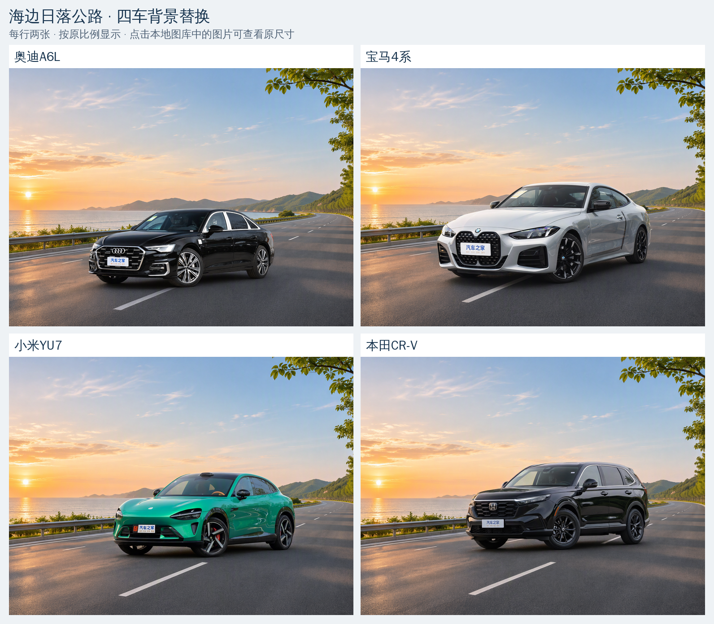
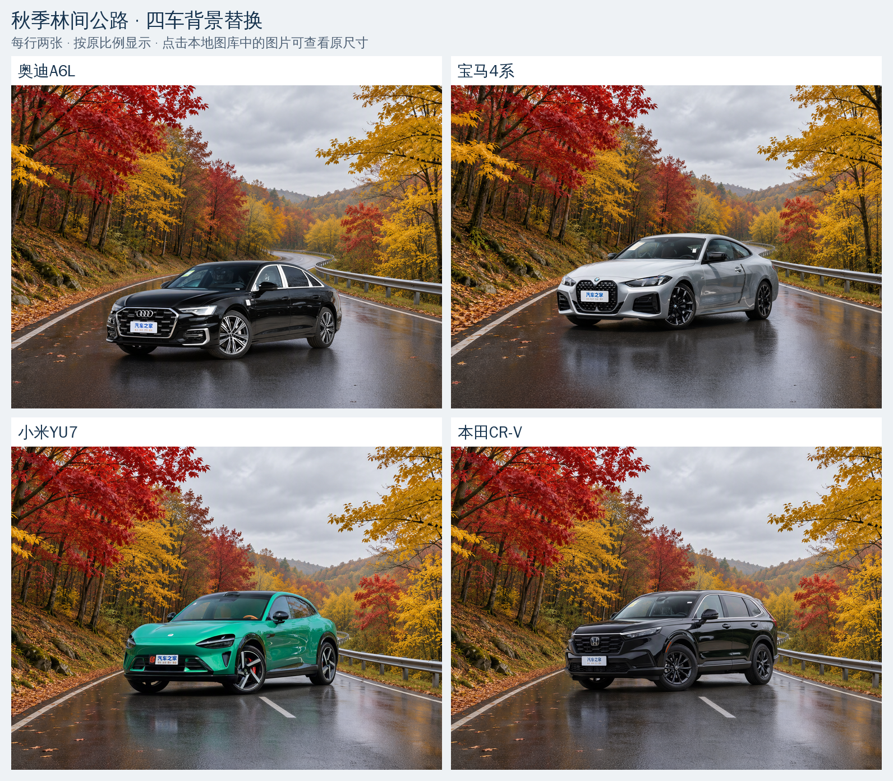
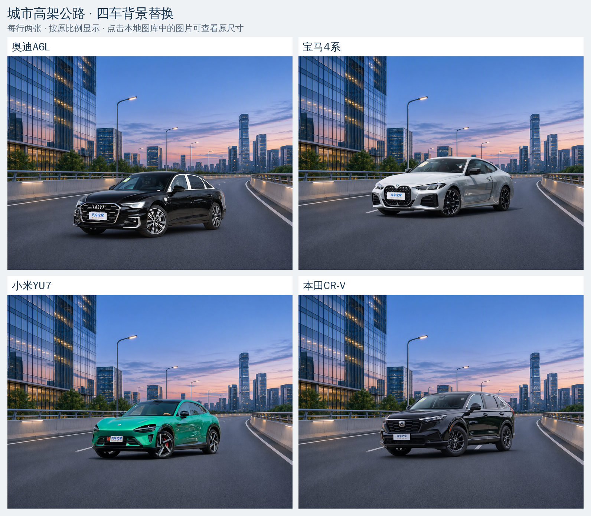

# 07 — 背景替换（清单方法 4）

[文档首页](README.md) · [项目首页](../README.md)

本模块使用服务器已有的 **Qwen-Image-2.1**，将车辆原图和用户提供的环境图作为两张参考，通过提示词进行背景替换。当前仅采用 Qwen，不引入其他模型、车辆抠图、分割 mask 或原车像素贴回。方法目录按建立顺序命名为 `07_background_replacement/`，对应增强清单中的方法 4。

已完成**三个背景 × 四辆车，共 12 张成图**：海边公路、秋季林间公路和城市高架公路，分别用于奥迪 A6L、宝马 4 系、小米 YU7、本田 CR-V。批次 `background_3x4_v1` 为每个组合重新生成，不复用此前小米单图成品。12 项文件核验与人工视觉检查均已完成，当前效果和原图对比见下方；尚未进行车系分类推理、分类训练或训练收益验证。

**当前首要目标是保持车辆主体的细粒度判别特征，使它仍应被识别为正确车系。** 允许车辆整体等比缩放和平移，以适配海边道路和自然构图；车灯、前脸、车身轮廓、窗线、轮毂等车系特征应保留，不允许改变这些设计特征或造成车体变形。车辆在画面中的大小与位置变化本身不再作为不合格条件，逐像素一致也不是当前验收目标。本轮只进行视觉检查，没有运行车系分类器或训练评测，不能声称已经验证分类结果正确。

实现入口：[单图运行脚本](../07_background_replacement/run.py)、[批次运行脚本](../07_background_replacement/run_batch.py) 与 [报告脚本](../07_background_replacement/build_report.py)。整图与部件对照复用 [Qwen 天气模块的预览函数](../02_qwen_image_edit/run.py)，既有天气及遮挡方法保持独立。

## 效果与原图对比

以下图片随仓库保存在 `docs/assets/background-replacement/`，可直接在 GitHub 浏览，无需先生成本地 `outputs/`。三张效果总览均为 **2×2**：上排为奥迪 A6L、宝马 4 系，下排为小米 YU7、本田 CR-V。每行两张、保持原比例；可打开大图或下方的 1536×1152 原尺寸成图查看。

**海边日落公路**



[查看海边组大图](assets/background-replacement/background_coastal.png)

**秋季林间公路**



[查看秋林组大图](assets/background-replacement/background_autumn.png)

**城市高架公路**



[查看城市组大图](assets/background-replacement/background_city.png)

每辆车另有一张 **“原图＋三个背景”2×2 对比图**，左上为原图、右上为海边、左下为秋林、右下为城市。原图等比缩至展示尺寸，便于查看背景与车辆外观变化；不将移动后的固定 ROI 误作对应部件对比。

| 车辆 | 原图与三个背景对比 |
| --- | --- |
| 奥迪 A6L | [打开对比大图](assets/background-replacement/vehicle_audi_a6l.png) |
| 宝马 4 系 | [打开对比大图](assets/background-replacement/vehicle_bmw_4.png) |
| 小米 YU7 | [打开对比大图](assets/background-replacement/vehicle_yu7.png) |
| 本田 CR-V | [打开对比大图](assets/background-replacement/vehicle_honda_crv.png) |

原尺寸成图均为 **1536×1152 PNG**，下表仅放文字链接，避免表格布局挤压图片比例：

| 车辆 | 海边日落公路 | 秋季林间公路 | 城市高架公路 |
| --- | --- | --- | --- |
| 奥迪 A6L | [原尺寸 PNG](assets/background-replacement/coastal__audi_a6l.png) | [原尺寸 PNG](assets/background-replacement/autumn__audi_a6l.png) | [原尺寸 PNG](assets/background-replacement/city__audi_a6l.png) |
| 宝马 4 系 | [原尺寸 PNG](assets/background-replacement/coastal__bmw_4.png) | [原尺寸 PNG](assets/background-replacement/autumn__bmw_4.png) | [原尺寸 PNG](assets/background-replacement/city__bmw_4.png) |
| 小米 YU7 | [原尺寸 PNG](assets/background-replacement/coastal__yu7.png) | [原尺寸 PNG](assets/background-replacement/autumn__yu7.png) | [原尺寸 PNG](assets/background-replacement/city__yu7.png) |
| 本田 CR-V | [原尺寸 PNG](assets/background-replacement/coastal__honda_crv.png) | [原尺寸 PNG](assets/background-replacement/autumn__honda_crv.png) | [原尺寸 PNG](assets/background-replacement/city__honda_crv.png) |

这 19 张展示文件直接复制自本批的 12 张成图和 7 张报告 PNG，未重新生成、编码或调整图像内容；来源、尺寸与 SHA-256 见[展示素材清单](assets/background-replacement/manifest.json)。完整本地报告及推理记录仍保留在方法的 `outputs/`，见下方“输出与检查”。主要车系特征目视仍对应原车，但小字、微纹理及部分旧反射仍有变化，城市组部分车体偏原日间亮度；这不是分类器验证或逐像素保真保证。

## 三背景、四车型批次

[批次配置](../07_background_replacement/configs/background_3x4_v1.json) 列出全部 12 项任务。每项使用独立的 `configs/background_3x4_v1/<背景>__<车辆>.json` 和 `prompts/background_3x4_v1/<背景>__<车辆>.txt`，明确车辆原图、背景参考及提示词。车辆与背景组合按背景优先排列。

| 车辆标识 | 原图 | 海边公路 `coastal` | 秋季林间公路 `autumn` | 城市高架 `city` |
| --- | --- | --- | --- | --- |
| `audi_a6l` | [奥迪 A6L](../test_images/奥迪A6L.jpg) | 1 张 | 1 张 | 1 张 |
| `bmw_4` | [宝马 4 系](../test_images/宝马4系.jpg) | 1 张 | 1 张 | 1 张 |
| `yu7` | [小米 YU7](../test_images/小米YU7.jpg) | 1 张 | 1 张 | 1 张 |
| `honda_crv` | [本田 CR-V](../test_images/本田CR-V.jpg) | 1 张 | 1 张 | 1 张 |

各项均采用 1536×1152、seed 42、40 步，在选定 GPU 上串行推理。提示词延续单图 v3 的“车系特征优先、允许整体等比缩放和平移”，并按各车和背景调整描述。报告按背景生成三张 **2×2** 四车图，按车辆生成四张“原图＋三个背景”的 **2×2** 对照，不将 12 张缩在同一行；原尺寸成图与双图对照保留独立入口。

## 单图阶段记录

| 版本 | 配置与提示词 | 用途与状态 |
| --- | --- | --- |
| v1 | [配置](../07_background_replacement/configs/yu7_coastal_v1.json) · [提示词](../07_background_replacement/prompts/yu7_coastal_v1.txt) | 原四段提示词的历史基线；已完成，记录到车辆放大、下移 |
| v2 | [配置](../07_background_replacement/configs/yu7_coastal_v2.json) · [提示词](../07_background_replacement/prompts/yu7_coastal_v2.txt) | 原要求下增加坐标提示的历史试验；已完成，车辆大小与位置接近 v1 |
| v3 | [配置](../07_background_replacement/configs/yu7_coastal_v3.json) · [提示词](../07_background_replacement/prompts/yu7_coastal_v3.txt) | 单图阶段的已生成版本；优先保留车系细粒度判别特征，允许整体等比缩放和平移并协调接地构图 |

v1、v2 输出保留供复核，不再按“大小与位置必须不变”评判当前任务。`run.py` 的默认配置仍为 v1，便于复现原提示词；当前批次通过显式配置运行，单图复跑示例也显式指定 v3。

## 背景素材归档（2026-11-13）

三张用户附件按收到顺序保存到 `07_background_replacement/assets/backgrounds/`，保留 PNG 原始字节，没有缩放、裁剪、调色或重新编码。源文件与项目副本逐字节及 SHA-256 核对一致；素材来源、原附件路径、尺寸、字节数和完整哈希见 [素材清单](../07_background_replacement/assets/backgrounds/manifest.json)。素材由用户提供，未独立验证其是否属于实拍照片。

| 顺序 | 背景 | 原始尺寸与模式 | 本轮用途 |
| --- | --- | --- | --- |
| 1 | [海边公路](../07_background_replacement/assets/backgrounds/01_coastal_road.png) | 1672×941，RGB | 四车型背景替换参考 |
| 2 | [秋季林间公路](../07_background_replacement/assets/backgrounds/02_autumn_forest_road.png) | 1672×941，RGB | 四车型背景替换参考 |
| 3 | [城市高架公路](../07_background_replacement/assets/backgrounds/03_city_elevated_road.png) | 1536×1024，RGB | 四车型背景替换参考 |

## 双参考与提示词

输入顺序固定为 `image=[vehicle_canvas, background_reference]`：

1. 图 1 是当前任务的车辆原图，提供汽车外观、车身比例和朝向参考；当前允许改变整体画面占比与位置。
2. 图 2 是当前任务的背景素材，提供道路、天空、植被或建筑等环境参考。海边、秋林与城市高架分别使用对应背景，不混用场景描述。

v1 沿用用户最初给出的“主体保护、背景替换、融合要求、输出要求”四段提示词，仅将消息中的反斜线排版整理为段落换行。该历史版本要求保留原有大小和位置。v2 保持相同输入、seed 和其他推理参数，并在四段文字前补充原场景中整车、前后轮和头灯在 1536×1152 画布上的坐标，尝试固定构图。两版都出现车辆放大、下移，属于基于旧要求的试验记录。

用户随后明确允许改变车辆大小与位置，并将“车辆细粒度特征不变、仍能识别为正确车系”作为核心目标。v3 按此调整提示词，把车系判别特征保持设为最高优先级，允许车辆作为整体等比缩放和平移，让轮胎与海边道路自然接触、构图合理。这里允许的是整体位置与画面占比变化，不包括拉伸车身、改变轮毂或灯具造型、增删影响车系识别的部件；v1、v2 的坐标漂移不再构成当前验收失败条件。

实际推理读取配置 JSON 的 `prompt` 字段；独立 `.txt` 是便于阅读的相同内容副本。调整提示词时应同步更新两份内容。

v1、v2 中“不重新生成汽车”和“保持原始视觉像素”的表述只是提示词目标，**不是当前实现提供的像素锁定能力**；v3 对车型及部件的保护同样属于软约束。管线未接入 `mask_image`、`strength` 或局部区域锁定；车辆轮廓、灯具、轮毂、车牌文字、漆面反射等仍可能被模型改变。脚本读取场景配置中的车辆多边形与部件框，用于生成后的固定坐标对照；v2 的坐标描述也未作为模型的结构条件或硬性保护区域。当前允许移动和缩放后，原坐标裁剪可能不再对准同一部件，不能把裁剪区域的差异直接当作车体变形证据。

四张原车辆照片均为 3840×2880，输入前以 **0.4 倍**等比例缩至 **1536×1152**，保持 4:3，无补边。输出显式指定同样的 1536×1152，不采用背景图的横向画幅，也不放大回原图尺寸。背景归档文件保持原尺寸；管线内部按面积和 32 像素对齐处理参考图，是近似原比例尺寸，并非精确等比例缩放。本批海边与秋林参考内部尺寸为 **1760×992**，城市高架为 **1632×1088**，各任务的实际映射保存于其 `manifest.json`。

本方法由 Qwen 直接生成整张结果。后处理仅去掉已记录的输入补边，本轮无补边可去；不抠出原车、不贴回原车像素、不另加阴影或锐化。输出若带有 alpha 通道，该通道也不能视为车辆保护 mask；预览显示时将其合到白底，原始生成 PNG 单独保留。

## 运行方法

以下命令从项目根目录执行。使用已有环境 `/nas/wyh/.conda/envs/car-weather-qwen21` 与共享权重 `models/Qwen-Image-2.1`，离线加载指定 revision `d26bb61231c349cf6b7896fa83353113880e1ba3`。新机器环境与模型准备见 [Qwen 编辑方法](02_qwen_image_edit.md)。

当前配置为 1536×1152、seed 42、40 步、BF16、CFG 1.0、KV cache 开启、VAE tiling 关闭。先检查可用 GPU，以下 GPU 2 只是本轮设备示例，复跑时应按实际空闲设备调整。

```bash
nvidia-smi

CUDA_VISIBLE_DEVICES=2 /nas/wyh/.conda/envs/car-weather-qwen21/bin/python \
  07_background_replacement/run_batch.py \
  --batch-config 07_background_replacement/configs/background_3x4_v1.json \
  --output-dir 07_background_replacement/outputs/background_3x4_v1_new_run

/nas/wyh/.conda/envs/car-weather-qwen21/bin/python \
  07_background_replacement/build_report.py \
  --batch-config 07_background_replacement/configs/background_3x4_v1.json \
  --batch-dir 07_background_replacement/outputs/background_3x4_v1_new_run
```

批次推理完成后再构建报告。复跑使用新的输出目录，避免覆盖已有样图。若仅需单图试验，可显式传入对应配置；以下命令复跑此前小米海边 v3：

```bash
CUDA_VISIBLE_DEVICES=2 /nas/wyh/.conda/envs/car-weather-qwen21/bin/python \
  07_background_replacement/run.py \
  --config 07_background_replacement/configs/yu7_coastal_v3.json \
  --output-dir 07_background_replacement/outputs/yu7_coastal_v3_new_run \
  --check-config

CUDA_VISIBLE_DEVICES=2 /nas/wyh/.conda/envs/car-weather-qwen21/bin/python \
  07_background_replacement/run.py \
  --config 07_background_replacement/configs/yu7_coastal_v3.json \
  --output-dir 07_background_replacement/outputs/yu7_coastal_v3_new_run
```

`--check-config` 检查文件、场景记录、模型 revision 和输入尺寸映射，不加载模型权重、不生成结果，也不会创建输出目录；仍需已安装的模型依赖和模型下载元数据。正式输出目录必须尚不存在，重复运行需要换目录名。配置中的文件路径相对于项目根目录解析，命令行相对路径按执行目录解析。

更换背景时，在新配置中修改 `reference_image` 与对应提示词即可。更换车辆时还需更改 `input_image`，并为该文件名提供对应的 `scene_config` 车辆轮廓和部件区域，不能直接沿用其他车辆的固定坐标。当前四车已有各自场景记录。

## 输出与检查

本批输出根目录为 `07_background_replacement/outputs/background_3x4_v1/`，每项结果位于 `jobs/<背景>__<车辆>/`。例如 `jobs/autumn__bmw_4/edited.png` 是宝马 4 系的秋林背景结果。本地报告位于该目录的 `report/index.html`；三张背景分组图为 `report/background_coastal.png`、`report/background_autumn.png` 和 `report/background_city.png`，四张车辆对照为 `report/vehicle_<车辆>.png`。页面最多两列展示，并可打开原尺寸图片及原图／结果双图对照。完整本地报告依赖生成目录，克隆仓库后需先按命令生成；GitHub 上可直接查看前文归档的效果图与对比图。

批次根目录的 `batch_manifest.json` 记录各项运行与耗时，`verification.json` 记录文件核验，`visual_review.json` 记录 12 项人工审查；`report/report_manifest.json` 保存报告图片及来源哈希。

此前单图输出仍保留于 `outputs/yu7_coastal_v1/`、`yu7_coastal_v2/` 和 `yu7_coastal_v3/`。完整生成目录、模型权重及环境缓存由 Git 忽略，素材、配置和脚本保留在各自方法目录中。以下表格描述每项生成目录：

| 文件或目录 | 内容 |
| --- | --- |
| `source_canvas.png` / `source_working.png` | 模型的车辆输入画布／同尺寸原图对照 |
| `background_reference.png` | 传入管线前的背景参考快照；不代表管线内部缩放后的尺寸 |
| `edited_canvas.png` / `edited.png` | 原始生成画布／移除已记录补边后的结果 |
| `previews/overview.png` | 原图与结果的无损整图对比 |
| `previews/` / `crops/` | 整车、接地区域和车灯、格栅、前后轮的对照与固定坐标裁剪 |
| `crop_regions.json` | 部件区域及实际裁剪坐标 |
| `inspection_corresponding_parts/`（v3） | 人工选取实际对应部件的整车／细节对照；`inspection_manifest.json` 保存框坐标和来源哈希，仅等比适配展示，不用于几何测量 |
| `manifest.json` / `progress.json` | 输入与实现哈希、尺寸映射、运行状态、步骤、耗时和显存记录 |
| `config.json` / `prompt.txt` / `scene_reference.json` | 运行参数、提示词及场景快照 |
| `run_snapshot.py` / `weather_helpers_snapshot.py` / `environment_freeze.txt` | 推理脚本、预览辅助脚本及依赖版本快照 |

当前检查重点是：背景是否确实匹配该任务的海边、秋林或城市高架素材；车辆整体缩放和平移后，灯具造型、前脸与格栅、车身轮廓及比例、窗线、轮毂等车系判别特征是否保留；轮胎接地、车底阴影、玻璃、车身反射与边缘是否自然。整体画面占比和位置变化可以接受，应结合整图和对应部件检查，不能仅凭原坐标裁剪偏移判定不合格。视觉核对只评估这些可见特征，没有用分类器验证识别正确率。

文件哈希与解码校验用于确认输入保护、产物完整性及可追溯性，不能代替视觉效果、车辆保真或训练收益评估。

## 批次结果与视觉检查（2026-11-13）

`background_3x4_v1` 的 **12/12 项全部生成完成**，每张为 1536×1152。另已生成三张背景四车总览、四张车辆“原图＋三背景”对照，共 7 张报告 PNG，以及可打开原尺寸图片的本地 HTML 报告。

逐项人工检查确认，三组分别呈现海边日落、秋林湿路和城市高架暮色，完整车辆、主要灯形、前脸、车身／窗线和轮毂等可见车系线索仍对应各自原图，接地总体可接受。未发现明显需要重试的严重变形、车系设计改变或额外车辆／人物，12 张均可供用户预览。整体缩放与平移按用户要求允许，不以原固定 ROI 的错位判定设计变化。

共同局限是小字、标识与微纹理仍有重绘或模糊，车漆和玻璃中的部分旧环境反射未完全消除；城市暮色组部分车体仍偏向原图的日间亮度，光照融合仍可改善。这些结论仅为人工目视检查，**没有运行车系分类器，不能保证分类正确率或所有细节完全不变**；用户验收仍待定。

文件核验通过：216 张管线 PNG 的哈希与解码、144 张固定坐标裁剪的逐像素核对、7 张报告 PNG 及 HTML 的 72 个本地链接；四张车辆原图和三张背景素材未改动。固定裁剪核验只确认报告产物正确，不代表不同构图下部件已经配准或车型保真得到自动验证。

批次生成总耗时 **863.657 秒（约 14 分 24 秒，含各进程初始化）**，单张推理为 41.021–41.268 秒，峰值已分配显存约 48.388 GiB，GPU 2 已释放。完整参数、输入／输出哈希与审查记录保存在上述批次和各项运行目录中。

## 单图阶段视觉记录

v1 与 v2 均已完成。两版的海边公路背景替换和轮胎接地整体自然，车辆相对原图有放大、下移，v2 增加坐标提示后这一变化仍存在。按最新要求，整体大小与位置变化本身可以接受；旧环境反射残留、轮毂及车牌小字重绘等细节仍需单独评估，不能以“允许移动缩放”替代车辆外观保真检查。

v3 已生成 1536×1152 成图，车辆整体缩小并右移，海面、日落、公路、护栏和树木的环境特征清晰，轮胎与路面接触、车底阴影整体自然。人工核对实际对应部件后，头灯外轮廓及灯带、前脸开口、窗线、车身轮廓、五辐轮毂与红色卡钳目视仍对应原车，未见明显改变为其他车系的设计。车身侧面与玻璃中仍有原环境反射痕迹，车牌小字、轮胎字及轮心标识存在重绘或模糊。当前结果供用户查看，不代表已经验证车系分类正确率或训练数据质量。

v3 的 `inspection_corresponding_parts/details_manual_comparison.png` 提供灯具、前脸、前后轮与车窗的五行两列对照；`vehicle_comparison.png` 将对应整车区域等比适配到同一展示面积，便于排除整体缩放、移动的干扰。两者只用于目视核对，不改动生成原图，不代表已做精确配准。

单图 v3 成图和对比位于本地 `07_background_replacement/outputs/yu7_coastal_v3/edited.png` 与 `previews/overview.png`。v3 推理约 41.010 秒，全流程约 56.388 秒，峰值已分配显存约 48.325 GiB。三轮各 18 张管线 PNG 的哈希与解码、12 张固定坐标原生裁剪的逐像素核对均通过；输入及实现快照未变。各输出目录的 `verification.json` 保存文件检查，`visual_review.json` 保存人工视觉记录。
